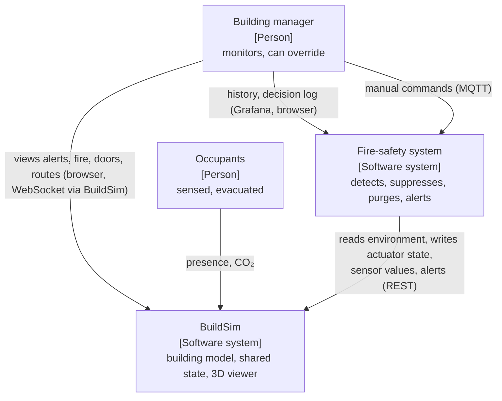
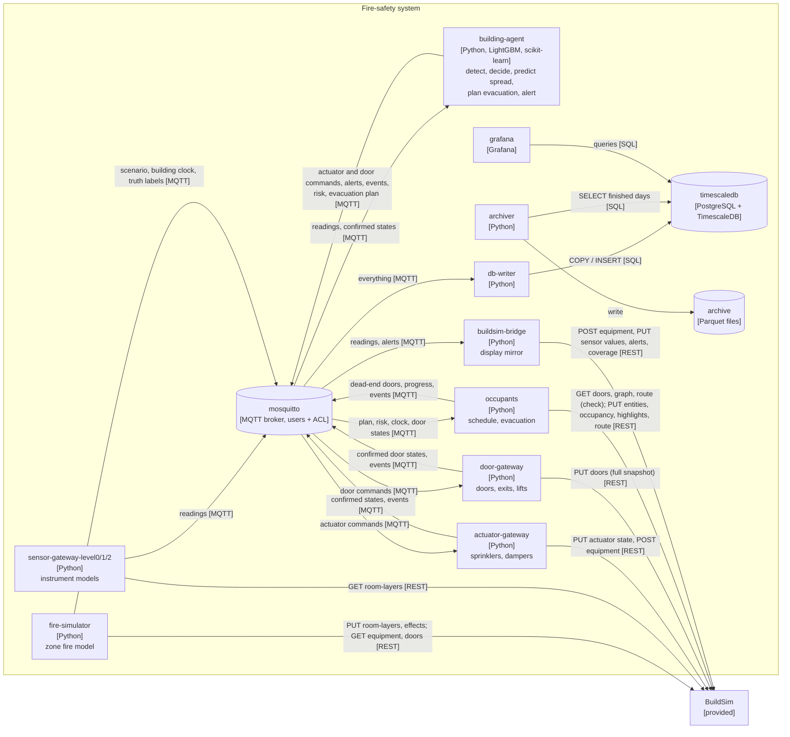
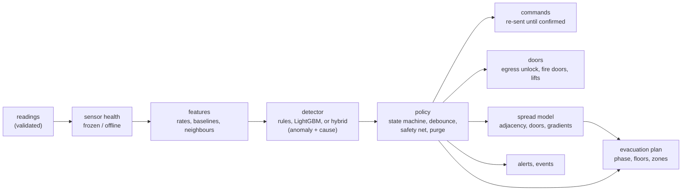
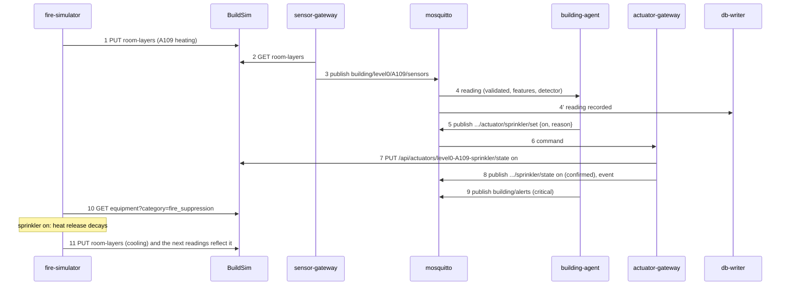

# System architecture: fire detection, suppression and evacuation

This document describes the system **as built** on top of BuildSim. BuildSim's
own [architecture](../architecture.md) describes the provided server and
viewer; this one describes the processes around it. It is the contract
between the design and the code: every container below is a service in
`compose.override.yaml` and a file in `devices/`, and every requirement in
section 4 names the test that verifies it. Section 2 lists what changed since
the first version of this document and why. Everything in the project
description is built and has run on the real BuildSim; the plan is in
[implementation-plan.md](implementation-plan.md).

## 1. Goal and scenario

Detect a real fire in any of the building's 956 rooms and corridors from the
combined rise of heat, smoke and CO; reject look-alike events (cooking,
steam, dust, smoking, heaters) and faulty sensors, also as anomalies against
normal behaviour; release the sprinkler in the burning zone only; unlock the
access-controlled doors for egress, close the fire doors and recall the
lifts; purge smoke from every zone it reaches; predict which zones the fire
will reach next; and plan the evacuation floor by floor, guiding the
occupants along routes that avoid fire, smoke, predicted spread and blocked
doors. The BuildSim viewer shows red = fire, orange = risk, green = safe,
smoke as coverage zones, the doors, the alerts and the evacuation routes;
Grafana shows the history and the agent's decision log.

**Demo scenario.** A waste-paper basket smoulders in office A109 for two
minutes, then flames and grows as a fast t² fire. Half of the building's doors
are open. Without the system the room flashes over after about five minutes,
smoke fills the corridor, the rooms across it and, via the stairwell next to
A104, the floor above. With the system, the heat detector in A109 crosses its
rate-of-rise limit ~30 s after flaming starts, the agent releases the A109
sprinkler and the fire dies within a minute. Already at the smoke alarm
(during the smouldering phase) the fire doors on level 0 have closed, so the
smoke stays in A109 (peak 0.5 %/m in the corridor instead of 44 %/m with the
doors left as they were), and the purge damper clears it within six
simulated minutes. The lifts are recalled; the occupants, who arrived at
work that morning following a daily schedule, are routed around A109 through
the closed (but unlocked) fire doors.

**Actors.** The *building manager* monitors the viewer and the alert list and
can command an actuator by hand (the agent adopts a manually started
sprinkler). *Occupants* are sensed (their CO₂ and their presence) and
evacuated, but are not on the control path. *BuildSim* is the building
environment and the shared state.

## 2. Changes since the first version

| Area | First version | As built | Why |
|---|---|---|---|
| Messaging between our processes | HTTP + JSON everywhere; a broker "if throughput requires it" | **MQTT** (Mosquitto) for readings, commands, confirmations, alerts and events; REST only towards BuildSim | 956 zones × 4 signals every 2 s, with four consumers (agent, database, bridge, tests). Pub/sub fans out once per reading and the retained/last-will features give restart and crash detection for free |
| Pipeline service with `/features`, `/readings` | separate `pipeline` REST service | **db-writer** (MQTT → TimescaleDB) plus features computed **inside the agent** (`features.py`) | The agent needs the features every 2 s for every zone; a REST round trip per decision adds latency and a failure point. The same `features.py` is used for training, so there is no train/serve skew |
| Model service (`/classify`, `/spread`) | separate container, five classes | **in-process models** in the agent: rules, a LightGBM fire probability, or the *hybrid* (rules + isolation forest/autoencoder anomaly detection + a four-class cause classifier); a LightGBM **spread predictor** on adjacency, doors and temperature gradients | One model call per tick for all zones takes milliseconds; no network hop on the safety path |
| One process per device | per-room sensor/actuator processes | **gateways**: one sensor gateway per floor, one actuator gateway | ~4,800 per-device processes would not fit a laptop; real buildings use gateways (BACnet/LoRa/Zigbee) the same way |
| Physics | linear diffusion `x += Σ k(x_n − x)` | **zone fire model** (t² growth, MQH/Alpert, plume filling, door flows, flashover, spread, sprinklers, purge, stairs, corridor cells) | The detection problem only exists when heat, smoke and CO behave realistically, including smoke drifting into rooms that are not burning |
| Agent states | NORMAL → SUSPECT → CONFIRMED_FIRE → SUPPRESSING → CONTAINED → CLEARED | NORMAL → ALARM → SUPPRESSING → COOLDOWN, plus a per-zone smoke-purge state | SUSPECT/ALARM and CONTAINED/COOLDOWN turned out to be the same states; the purge was added for smoke removal |
| Fire doors | door actuator that unlocks doors on the routes | **door gateway** owning BuildSim's whole door collection (804 room doors on their entry nodes, fire exits, lift lobbies) with an **access-control schedule** (offices and stairwells locked out of hours, secure rooms always); on any alarm the agent **unlocks** every access-controlled door for egress and *closes* the floor's fire doors (closed, unlocked) and recalls the lifts; door-lock equipment with position sensors in BuildSim | Unlocking only means something if doors are locked in normal operation; closing doors is what limits smoke spread. `PUT /api/doors` replaces the collection, so exactly one process may write it |
| Evacuation plan | the agent computes a `/plan`; occupancy sampled per room type | the **agent owns the plan** (`building/evacuation/plan`: phase, floors, hazard and risk zones, exits, doors, versioned); the `occupants` service follows it with hazard-weighted routes (cross-checked against BuildSim's route API) and reports progress | The agent decides *when* and *which floors*; routing for individual people, with its own failure modes, stays out of the safety-critical process |
| Dashboard | separate dashboard bridge with coverage, highlights and a side panel | the BuildSim viewer (red/orange/green highlights from the plan, smoke **coverage** zones from the bridge, routes, layers, effects, doors, alerts) plus **Grafana** over TimescaleDB with the decision log | A provisioned Grafana gives time series and a log without writing a web app |
| Time | each process its own clock | **one building clock** published by the simulator (`sim/clock`); agent, door schedule and occupants follow it | The access schedule, the occupants' day and the agent's timers must agree, also across restarts |
| Actuator authorisation | shared secret per issuer | **MQTT users and ACLs** (one user per service, only its own topics) plus validation in every gateway; door commands also checked against allowed sources | The broker is the single entry point for commands, so it is the natural place to enforce who may send them |
| Process lifecycle | not specified | every service: Starting → Syncing → Running ⇄ Degraded → Stopped, published on its status topic; Docker health check from a heartbeat; watchdog; clean SIGTERM | The guide's lifecycle requirement, and a gateway that cannot read BuildSim must stop publishing rather than send stale readings with fresh timestamps |
| Storage | time-series store to be decided | **TimescaleDB** hot (raw, compressed after a day, 30 days) and warm (per-minute aggregate) tiers, **Parquet** cold archive | Fast recent queries for the dashboard and evaluation; cheap long-term history for training |

## 3. Boundaries and kinds of state

BuildSim stores only the **latest** state and renders it. It does not simulate
physics, decide anything or keep history. Everything below lives outside
BuildSim and talks to it only through its REST API. BuildSim is **not
modified; it is instrumented**: it is the shared state of the cyber-physical
system, and the control loop closes through it.

| Kind | Meaning | Where it lives |
|---|---|---|
| **Truth** | What the simulated world is doing | BuildSim room layers and effects (written by the simulator); labels on `sim/truth/...` for the database |
| **Observation** | What a device reports, with lag, noise and faults | MQTT `building/<level>/<room>/sensors`; BuildSim sensor values (display) |
| **Decision output** | What the agent believes and did | Actuator state in BuildSim (applied) and on MQTT (confirmed), alerts, events |

The decision side never reads truth. The agent sees only sensor observations,
which is what makes false-alarm rejection a real problem.

## 4. Requirements

Every requirement names the design element that satisfies it (section) and
the test that verifies it. "Simulated s" are seconds of simulated time.

| ID | Type | Requirement | Priority | Acceptance criterion | Design | Verified by |
|---|---|---|---|---|---|---|
| FR-01 | Functional | Release the sprinkler in a zone with a flaming fire | Must | Released ≤ 60 simulated s after flaming in ≥ 95 % of fires | §11 | `baseline.py` (detected, release delay); `test_fire_is_detected_and_suppressed_through_buildsim` |
| FR-02 | Functional | Do not release where there is no fire (nuisances, smoke from next door, faulty sensors) | Must | ≤ 1 false release per 100 zone-hours | §11 | `train_model.py` event metrics; `baseline.py` (false releases); `test_hot_smoke_from_next_door_is_attributed_not_released` |
| FR-03 | Functional | Stop the water once the fire is out | Must | Stops after ≥ `MIN_DISCHARGE_SECONDS` once the zone is ≤ 35 °C and not heating | §11 | `test_sprinkler_runs_its_minimum_time_then_stops_when_cool` |
| FR-04 | Functional | Purge smoke from every zone it reaches | Should | Damper opens at ≥ 3 %/m, closes at ≤ 0.5 %/m; smoke < 1 %/m in the tracked zones ≤ 15 simulated min after suppression | §8, §11 | `test_smoke_purge_opens_and_closes_with_hysteresis`, `test_smoke_purge_opens_dampers`, `response.py` |
| FR-05 | Functional | Alert the building manager | Must | One alert per zone in alarm/suppression, most severe first, ≤ 100; one alert per offline gateway | §11 | `test_fire_is_detected...`, `test_sensor_gateway_crash_and_recovery` |
| FR-06 | Functional | Route occupants out avoiding fire, smoke and impassable doors | Should | Routes avoid burning zones when an alternative exists; nobody is left without a route; a jammed or locked door triggers a re-plan | §13 | `test_jammed_door_makes_the_evacuation_replan`; `populate_evacuation.py --trigger manual` (demonstration) |
| FR-07 | Functional | Close fire doors on an alarm, recall the lifts on a fire | Should | Within one decision tick of an alarm the floor's fire doors are closed (unlocked); lift lobbies blocked on a confirmed fire; back to normal 120 simulated s after the last alarm | §11, §12.2 | `test_fire_alarm_closes_doors_and_recalls_lifts`, `test_agent_door_policy_closes_the_floor_and_recalls_lifts`, `response.py` (corridor smoke) |
| FR-08 | Functional | Enforce door safety rules whoever commands | Must | Locked doors are not opened without unlocking; fire exits are never locked or blocked; jammed doors cannot be operated; unknown sources refused | §12.2 | `test_door_rules_are_enforced`, `test_jammed_doors_and_exits_are_protected`, `test_snapshot_passes_buildsims_door_validation` |
| FR-09 | Functional | Realistic occupancy over the day | Should | Arrivals 07–09, lunch dip, departures 16–18, empty nights and weekends | §13 | `test_schedule.py` |
| NFR-01 | Non-functional | Decide for the whole building every tick | Must | Agent step ≤ 0.5 s for 956 zones (decision interval 2 s) | §11 | `scaling.py` |
| NFR-02 | Non-functional | Survive a sensor-gateway crash | Must | Offline alert ≤ 30 s after the crash; readings back ≤ 30 s after restart | §17 | `test_sensor_gateway_crash_and_recovery` |
| NFR-03 | Non-functional | Survive an agent restart without stopping water | Must | A running sprinkler stays on through the restart | §17 | `test_agent_restart_keeps_a_running_sprinkler_on` |
| NFR-04 | Non-functional | Survive a BuildSim restart | Must | Equipment and non-default actuator states restored ≤ 30 s | §17 | `test_buildsim_restart_is_recovered` |
| NFR-05 | Non-functional | Never act on corrupt data | Must | Malformed, non-numeric, impossible, future and duplicate readings are rejected and reported | §7, §10 | `test_messages.py`, `test_corrupt_sensor_data_is_rejected` |
| NFR-06 | Non-functional | Apply commands quickly | Should | Command → applied in BuildSim and confirmed ≤ 1 s (p90) | §12 | `latency.py` |
| NFR-07 | Non-functional | Detect a fire with a broken sensor in the fire room | Should | Frozen or offline temperature sensor: fire still released, no flashover | §9, §11 | `baseline.py --faults`, `test_faulty_thermometer_falls_back_to_smoke_and_co` |
| NFR-08 | Non-functional | Degrade safely on bad inputs | Must | Two gateways offline or > 20 % of zones stale: the agent reports Degraded within 10 s, raises a critical alert, never switches water off, and returns to Running when inputs recover; a sensor gateway that cannot read BuildSim stops publishing and reports Degraded | §15.3 | `test_degraded_mode`, `test_gateway_degrades_when_buildsim_is_unreachable` |
| NFR-09 | Non-functional | Stop cleanly and restart when hung | Should | SIGTERM: "offline" published by the service itself; a loop silent for 30 s fails the health check, for 120 s exits for a restart | §15.3 | `test_graceful_shutdown`, `test_lifecycle.py` |
| NFR-10 | Non-functional | Keep history cheaply | Should | Raw samples compressed after 1 day and kept 30 days; per-minute aggregate kept; every finished day archived to Parquet | §10 | `archive.py` run (Parquet files), db-writer storage log |
| FR-10 | Functional | Unlock access-controlled doors for egress on a fire alarm | Must | Out of hours the office and stairwell doors are locked; within one decision tick of any alarm > 85 % of them (all but secure rooms) are unlocked; fire exits are never locked; the schedule returns after the all-clear | §11, §12.2 | `test_fire_alarm_unlocks_egress_doors`, `test_access_schedule_locks_after_hours`, `test_agent_unlocks_egress_on_any_alarm` |
| FR-11 | Functional | Detect anomalies against normal behaviour and classify their cause | Should | ≥ 98 % of fires and nuisances anomalous within 60 simulated s; ≤ 1 false anomaly per 100 normal zone-hours; cause accuracy reported per class; non-fire anomalies give a "check zone" alert, not water | §11 | `train_anomaly.py` (`results/anomaly`), `test_anomaly.py`, `baseline.py` (hybrid) |
| FR-12 | Functional | Predict fire spread | Should | AUC ≥ 0.85 on held-out scenarios and better than the neighbour baseline; zones flagged ≥ 60 s before they become untenable reported | §11 | `train_spread.py` (`results/spread`), `test_spread.py` |
| FR-13 | Functional | The agent orchestrates the evacuation | Should | One versioned plan per change (phase, floors, zones, exits, doors); phased floors never shrink during an evacuation; occupants follow it, the all-clear only comes from the agent; people awaiting rescue raise a critical alert | §11, §13 | `test_plan_is_phased_then_full_then_all_clear`, `test_agent_plan_drives_the_evacuation` |
| FR-14 | Functional | Dashboard as specified | Should | Viewer highlights red = fire, orange = smoke/risk, green = exits and escape corridors; smoke as coverage zones that pass BuildSim's validation; evacuation route shown | §14 | `test_dashboard_highlights_and_coverage` |
| FR-15 | Functional | Evacuation routes consistent with BuildSim's route API | Should | Without hazards the local planner and `/api/graph/route` agree (≤ 5 %) on the same door snapshot; mismatches logged | §13 | `test_routes_agree_with_buildsims_route_api` |
| NFR-11 | Non-functional | One clock | Should | Agent, door schedule and occupants follow `sim/clock`; a stale clock falls back without jumping; decision time never runs backwards | §11 | `test_clock.py`, `test_agent_plan_drives_the_evacuation` |
| NFR-12 | Non-functional | Survive a broker outage (network drop) | Must | Every service reconnects by itself (1–10 s back-off), re-subscribes and re-publishes its status; the agent is Degraded while its inputs are stale and never switches water off; readings and Running ≤ 30 s after the broker returns | §15.3 | `test_broker_outage_degrades_and_recovers` |
| SEC-01 | Security | Only authorised services may command actuators and doors | Must | Without a login the broker refuses; a sensor-gateway login cannot publish a sprinkler command | §20 | `test_broker_enforces_users_and_acl` |
| SEC-02 | Security | Encrypted broker connections and secrets outside the repository | Should | TLS listener with a verified broker certificate; plain MQTT and an unknown CA refused on it; passwords from `.env` | §20 | `test_tls.py` |
| SAF-01 | Safety | A learned model is never the only thing between a fire and the water | Must | A healthy temperature sensor at ≥ 90 °C releases regardless of the detector | §11 | `test_safety_net_releases_even_when_the_detector_says_no` |
| REG-01 | Regulatory | Escape doors usable in a fire: doors on escape routes open in the direction of escape without a key; electrically locked doors are released by the fire alarm (Boverket's rules for escape doors; SS-EN 13637 for electrically controlled exit systems) | Must | Fire exits never locked or blocked, whoever commands; on any alarm the access control is released for the office and stairwell doors, relocked only after the all-clear | §12.2 | `test_door_rules_are_enforced`, `test_fire_alarm_unlocks_egress_doors`, live Run B |

## 5. Context (C4 level 1)



There is no external compute: model training (`train_model.py`) runs offline
on the same machine, off the control path. In a real deployment the control
loop would run on an edge server in the building; training and long-term
analysis are the parts that could move to the cloud.

## 6. Containers (C4 level 2)

One box per service in `compose.override.yaml`, protocol on every arrow.



| Container | Single responsibility | Tech | Why it is a separate process |
|---|---|---|---|
| `fire-simulator` | Advance the physics of every zone; write truth to BuildSim; read actuator and door state from BuildSim | Python | It *is* the environment; nothing on the decision side may share its memory |
| `sensor-gateway-<level>` (×3) | Turn the environment into realistic, faulty readings for one floor | Python | A crashed gateway takes down one floor's sensors, not all; floors scale out independently |
| `mosquitto` | Decouple producers from consumers, retain last values, last wills, enforce who may publish what | Mosquitto 2.0.18 | One source, many consumers; buffers a briefly absent consumer; one place for command authority |
| `building-agent` | Detect fires and decide sprinklers, dampers, egress unlock, fire doors and lifts for the whole building; predict spread; own the evacuation plan | Python, LightGBM, scikit-learn | The safety-critical logic, isolated from everything that can fail around it |
| `actuator-gateway` | Validate sprinkler/damper commands and apply them to BuildSim, then confirm | Python | "Deciding is not acting": a wrong command is rejected independently of the agent |
| `door-gateway` | Own BuildSim's door collection: access schedule, validate door commands against the door rules, publish the full snapshot, confirm; door-lock equipment | Python | `PUT /api/doors` replaces the collection, so one process must hold it; the door rules (exits never locked) hold whoever commands |
| `occupants` | People with a daily schedule; follow the agent's evacuation plan; routes, highlights, progress | Python (`populate_evacuation.py`) | Not on the control path; can crash or be left out without affecting fire control |
| `buildsim-bridge` | Register the detectors and mirror readings, alerts and smoke coverage into BuildSim | Python | BuildSim takes one request per value; rate limiting and deadbands live in one place, off the control path |
| `db-writer` | Record readings, truth labels, commands, states, events, scenarios; set up the storage tiers | Python, psycopg | Storage can be slow or down without affecting control |
| `timescaledb` | History (hot, warm), training data, audit trail | PostgreSQL 16 + TimescaleDB | The only durable record; BuildSim keeps nothing |
| `archiver` | Copy finished days to Parquet (cold tier) | Python, pyarrow | Batch work every 6 hours, independent of recording |
| `grafana` | Dashboard: readings, actuators, doors, decision log | Grafana 11 | Presentation separate from logic; read-only on the database |
| `tests` (profile `test`) | Unit, end-to-end, fault-injection tests | pytest | Own broker (same users and ACL, development passwords) and fake BuildSim, never touches a running stack |

## 7. Interfaces

### 7.1 Communication patterns

| Link | Pattern | Why |
|---|---|---|
| Sensor readings → agent, database, bridge | Pub/sub (MQTT, QoS 0, retained) | One source, three consumers; latest value retained for restarts; a lost reading is replaced 2 s later |
| Agent → actuator gateway (commands) | Pub/sub (MQTT, QoS 1), confirmed on a separate retained topic, re-sent every 10 s until confirmed | Commands must arrive; the confirmation tells the agent what was really applied |
| Agent, occupants, operator → door gateway | Pub/sub (MQTT, QoS 1), per door, per zone, per floor or all lifts; confirmed per door (retained) | One floor-wide command instead of hundreds; the gateway merges them into one snapshot |
| Grafana, archiver → database | SQL | Queries over history, not live data |
| Our processes ↔ BuildSim | Request–response (REST) | BuildSim's only interface; every call is a question or a state change that must succeed |
| BuildSim → browser | WebSocket (BuildSim's own) | Live view without polling |

### 7.2 MQTT topics

Room names are URL-encoded in topics (`A103+A112_B+A103` → `A103%2BA112_B%2BA103`).

| Topic | Producer → consumers | Payload (field: type, unit) | QoS / retain / rate |
|---|---|---|---|
| `building/<level>/<room>/sensors` | sensor gateway → agent, db-writer, bridge | `ts`: float s epoch; `gateway`: str; `temperature`: float °C (−40…1200); `smoke`: float %/m (0…100); `co`: float ppm (0…10 000); `co2`: float ppm (0…100 000) | 0 / yes / every 2 s per zone |
| `building/<level>/<room>/actuator/<name>/set` | agent or operator → actuator gateway | `state`: `"on"`/`"off"` (sprinkler) or `"0.0"`…`"1.0"` (damper); `reason`: str; `id`: str; `ts`; `source` | 1 / no / on change, re-sent every 10 s until confirmed |
| `building/<level>/<room>/actuator/<name>/state` | actuator gateway → agent, db-writer | `state`; `ts`; `command_id`; `reason`; `source` (published only after BuildSim accepted it) | 1 / yes / on change |
| `building/gateways/<name>/status` | gateways (lifecycle, last will) → agent, db-writer | `status`: `"online"`/`"degraded"`/`"offline"`; `state`: lifecycle state; `detail`; `since`; `ts` | 1 / yes / on change |
| `building/agent/status`, `building/services/<name>/status`, `sim/status` | the other services | same | 1 / yes / on change |
| `building/doors/<door id>/set`, `building/<level>/<room>/doors/set`, `building/<level>/doors/set`, `building/lifts/set` | agent, occupants, operator → door gateway | `state`: `open`/`closed`/`blocked`/`normal` and/or `lock_state`: `locked`/`unlocked`; `reason`; `id`; `source` | 1 / no / on change, re-sent every 30 s until applied |
| `building/doors/<door id>/state` | door gateway → db-writer, operator | `state`, `lock_state`, `kind`, `level`, `room`, `ts`, `command_id`, `reason`, `source` | 1 / yes / on change |
| `building/doors/<door id>/fault` | tests, operator → door gateway | `jammed`: bool (fault injection) | 1 / no |
| `building/doors/egress/set` | agent → door gateway | `lock_state`: `unlocked` (fire alarm) / `normal` (back to the schedule); `reason`; `id`; `source` | 1 / no / on change, re-sent until applied |
| `building/alerts` | agent → bridge | list of `{id, severity, title, message, level, room}`, most severe first | 1 / yes / on change |
| `building/risk` | agent → occupants, bridge, db-writer | `zones`: {zone: probability}; `horizon_s` (300); `model`; `threshold`; `ts` | 1 / yes / on a new zone set or a 0.1 change |
| `building/evacuation/plan` | agent → occupants, bridge, db-writer | `phase` (`normal`/`evacuate`/`all_clear`); `evacuate_levels`; `fire_zones`, `alarm_zones`, `smoke_zones`, `risk_zones`; `exits`; `doors` {`egress`, `closed_levels`, `lifts`}; `version`; `clock`; `ts` | 1 / yes / on change |
| `building/evacuation/progress` | occupants → agent, db-writer | `phase`; `levels`; `present`, `pre_movement`, `evacuating`, `evacuated`; `awaiting_rescue` {zone: n}; `route_checks`; `clock`; `ts` | 1 / yes / every 5 s during an evacuation |
| `building/events` | all services → db-writer | `ts`, `type` (`room_state`, `actuator_applied`, `command_rejected`, `actuator_write_failed`, `sensor_health`, `smoke_purge`, `data_quality`, `door_policy`, `door_applied`, `door_command_rejected`, `service_state`, `occupancy`, `spread_risk`, `evacuation_plan`, `evacuation_replan`, `route_check`, `evacuation_complete`), `severity`, `level`, `room`, `message`, extra fields | 1 / no |
| `sim/scenario` | simulator → sensor gateways (fault schedule), db-writer | scenario parameters (section 8) | 1 / yes / per scenario |
| `sim/clock` | simulator → sensor gateways, agent, door gateway, occupants, db-writer | `scenario_id`, `scenario_time` (simulated s), `sim_time` (simulated s since the simulator started), `week_minute`, `clock` ("Mon 07:31"), `ts` | 0 / yes / every tick |
| `sim/truth/<level>/<room>` | simulator → db-writer only | true physical values + labels (`fire_phase`, `fire_origin`, `nuisance_source`, `sensor_fault`) | 0 / yes / on change |

Consumers validate every reading (`messages.py`): a message that is not a JSON
object, misses a field, holds a non-number or NaN, is outside the range above,
is timestamped more than 60 s in the future, or is not newer than the last
accepted one for that zone is dropped and counted. The agent publishes the
counts as `data_quality` events.

### 7.3 BuildSim endpoint ownership

Collection `PUT`s replace everything, so each has exactly one writer.

| Endpoint | Sole writer | Readers |
|---|---|---|
| `POST /api/equipment/bulk`: `fire_detection-<level>-<room>` (sensors `-temp`, `-smoke`, `-co`, `-co2`) | `buildsim-bridge` | viewer |
| `POST /api/equipment/bulk`: `fire_suppression-<level>-<room>` (actuators `-sprinkler`, `-damper`) | `actuator-gateway` | `fire-simulator`, viewer |
| `POST /api/equipment/bulk`, `PUT` sensor/actuator: `door-<id>` (`door_lock`, `access_control`: binary position sensor, lock actuator) for fire exits, stairwell and secure doors | `door-gateway` | viewer |
| `PUT /api/actuators/{id}/state` | `actuator-gateway` | `fire-simulator` (`GET /api/equipment?category=fire_suppression`, one call per tick), viewer |
| `PUT /api/sensors/{id}/value` | `buildsim-bridge` (deadbanded, ≤ 150 requests/s) | viewer |
| `PUT /api/room-layers` | `fire-simulator` (truth: HRR, gas temperature, ceiling-jet velocity, obscuration, visibility, CO, CO₂, O₂, smoke-layer height) | `sensor-gateway-*` (`GET`, one call per tick), viewer |
| `PUT /api/effects` | `fire-simulator` (fire, smoke per corridor cell, sprinkler) | viewer |
| `PUT /api/alerts` | `buildsim-bridge` (the agent's list, first 100) | viewer |
| `PUT /api/doors` (full snapshot: room doors with `entry_node_id`, fire exits, lift lobbies) | `door-gateway` | `fire-simulator` (open/closed for smoke), `occupants` (blocked doors), BuildSim's own walkable routing (locked, jammed and blocked doors are excluded), viewer |
| `PUT /api/entities`, `/api/occupancy`, session highlights and route | `occupants` | `sensor-gateway-*` (people for CO₂), viewer |
| `PUT /api/coverage` (global smoke zones) | `buildsim-bridge` | viewer |
| `GET /api/graph/route` | – (read by `occupants`: everyday walks, and the cross-check of evacuation routes) | – |

## 8. Physical model (`fire_simulator.py`)

A two-zone model per *cell* (a room, or a ~4 m segment of a corridor), built
from standard fire-engineering correlations:

* **Fire**: optional smouldering, then a t² fire capped by fuel (250 kW/m²)
  and by ventilation (Kawagoe, 1500·A·√H kW); flashover at a 600 °C layer;
  decay after 70 % of the fuel load; spread by hot layer (500 °C) or by flames
  through a door (much slower through a closed door).
* **Temperature**: MQH hot-layer correlation with thermal lag, plus the Alpert
  ceiling jet at the detector.
* **Smoke**: Heskestad plume filling a descending ceiling layer; soot, CO and
  CO₂ yields that rise when the fire is short of air.
* **Doors**: each scenario has a share of doors open (`DOOR_OPEN_PROB`, 0.5);
  closed doors leak 1 % of their area. Buoyant door flows entrain room air, so
  smoke is cooler and thinner after every doorway.
* **Corridors** are split into cells along the walkable graph, so smoke
  travels down a corridor instead of reaching every door at once.
* **Stairs**: a stack flow carries hot smoke up the stairwells to the next
  floor.
* **Removal**: background ventilation (2 ACH), soot settling, and the purge
  damper (10 ACH when open).
* **Sprinklers**: heat release decays as exp(−t/43 s) (NIST), much less
  effectively after flashover; turning the water off early lets the fire
  regrow.
* **Nuisances**: cooking, steam, dust, heater and smoking sources produce
  smoke, heat or CO without a fire.
* Only *active* cells are integrated (fire, smoke, heat), so a quiet building
  costs almost nothing.

Each tick (2 s real, × `TIME_SCALE` simulated) the simulator reads the
actuator states from BuildSim, advances the model, and writes room layers and
effects to BuildSim. If BuildSim cannot be read, it keeps the last actuator
states rather than turning every sprinkler off.

Limitations (honest): well-mixed cells, no wind or stack effect between
floors other than through stairs, no HVAC duct network, CO₂ from occupants
modelled in the sensor rather than the physics, fuel per floor area rather
than per object.

## 9. Sensors and faults (`sensor.py`)

Each gateway reads the room layers once per tick and runs one instrument
model per zone: a heat detector with a response-time index (RTI 50), a
photoelectric smoke chamber with an entry lag (L/u), CO and CO₂ cells with
first-order responses, CO₂ from occupants (people counted from BuildSim's
entities and occupancy), noise, resolution and range. Sensor faults belong to
the device: the gateway applies the current scenario's fault schedule
(`sim/scenario` + `sim/clock`): smoke-chamber drift, frozen temperature,
smoke spikes, dead CO cell, or a device that stops publishing.

## 10. Data pipeline (`db-writer`, TimescaleDB)

```text
sensor gateways ──MQTT──▶ db-writer ──COPY──▶ samples (hypertable)
agent, actuators ─MQTT──▶ db-writer ──INSERT─▶ events, commands, actuator_states, scenarios
simulator (labels) ─MQTT▶ db-writer  (joined into samples as true_* and label columns)
```

* The broker buffers while the database is slow; db-writer reconnects and
  carries on.
* Busy zones are sampled every `RECORD_INTERVAL` (2 s), quiet zones every 5th
  tick, which keeps a whole building at ~450 rows per 2 s while a fire burns.
* Data quality: invalid and duplicate readings are rejected at ingestion; stale
  readings are flagged (`stale_signals`); frozen readings are detected by the
  agent (`health.py`).
* `export_dataset.py` turns recorded scenarios into the training format;
  `generate_dataset.py` produces the same format offline, much faster than
  real time.
* Storage tiers:

  | Tier | Where | Kept | Used by |
  |---|---|---|---|
  | hot | `samples` hypertable, compressed after 1 day | 30 days | agent evaluation, `latency.py`, Grafana zone panels |
  | warm | `samples_1m` continuous aggregate (per zone per minute) | as long as the database | Grafana floor panels, long-range queries |
  | cold | Parquet, `archive/<table>/date=YYYY-MM-DD/` (archiver, every 6 h, finished days) | forever | training, offline analysis (pandas, DuckDB) |

  Events are kept 365 days. On plain PostgreSQL (no TimescaleDB) db-writer
  creates `samples_1m` as a view and skips the policies.

## 11. Autonomous service (`building-agent`)

One agent for the whole building, every `DECISION_INTERVAL` (2 s):



* **Detectors.** *Rules*: smoke ≥ 8 %/m or CO ≥ 50 ppm alarm; ≥ 68 °C, or
  ≥ 8.3 °C/min with evidence of combustion (CO ≥ 10 ppm, a rise ≥ 16.6
  °C/min, or ≥ 50 °C), releases, unless a neighbour is hotter and
  heat-alarmed (smoke spilling in). The combustion condition was added after
  `baseline.py` showed cooking in rooms behind closed fire doors warming them
  by 9–12 °C/min with ~5 ppm CO (P6). *Model*: a LightGBM fire probability
  from 51 features (own signals, rates, baselines, neighbour context, sensor
  health, corridor flag), trained on generated scenarios (with the agent's
  sprinkler, purge and fire-door policy), release threshold chosen on
  validation data for ≤ 1 false release per 100 zone-hours. *Hybrid*
  (`anomaly.py`): the rules, plus an anomaly stage (isolation forest and an
  MLP autoencoder, 38 → 16 → 8 → 16 → 38, trained on normal periods only;
  each score divided by its threshold for ≤ 1 false anomaly per 100
  zone-hours on validation) and a cause stage (LightGBM, classes normal /
  fire / nuisance / sensor fault, on the 51 features plus the anomaly score).
  An anomaly classified as fire alarms, and releases water only above a
  confidence that met the false-release budget in training; any other
  anomaly gives a "check zone" alert. The rules' decisions always stand.
  `DETECTOR=rules` is the default; the model and the hybrid fall back to the
  rules if they cannot be loaded.
* **Per-zone states**: NORMAL → ALARM → SUPPRESSING → COOLDOWN → NORMAL (or
  ALARM if smoke remains). Conditions must hold for 2 ticks. The sprinkler
  runs at least `MIN_DISCHARGE_SECONDS` (300 simulated s) and stops when the
  zone is ≤ 35 °C and not heating.
* **Smoke purge**: damper opens at ≥ 3 %/m, closes once ≤ 0.5 %/m for 3 ticks
  and after ≥ 120 simulated s.
* **Egress, fire doors and lifts**: on any alarm the agent releases the
  access control (`building/doors/egress/set` `unlocked`: every office and
  stairwell door), commands the floor's fire doors closed
  (`building/<level>/doors/set`, closed but unlocked), on a confirmed fire it
  blocks the lift lobbies (`building/lifts/set`), and `DOOR_RESET_SECONDS`
  (120 simulated s) after the last alarm it returns them to `normal` (the
  schedule and their scenario state). Commands are re-sent until the door
  gateway confirms them.
* **Spread prediction** (`spread_model.py`): per zone and tick, the
  probability of becoming untenable (burning, ≥ 60 °C or ≥ 10 %/m) within 300
  simulated s, from 20 features over the adjacency graph: own temperature,
  rate, smoke and CO; per neighbour the temperature gradient and smoke,
  weighted by how open the connection is (open door or corridor opening 1,
  stairwell 0.5, closed door 0.03, from the door gateway's confirmed
  states); neighbouring fire and alarm; graph distance to the nearest
  confirmed fire; corridor and stair flags. LightGBM trained on closed-loop
  scenarios (`train_spread.py`), or a transparent baseline rule. Published on
  `building/risk`.
* **Evacuation plan**: phase `normal` → `evacuate` on any alarm →
  `all_clear` 180 simulated s after the last alarm. Phased floors: the alarm
  floors and the floors above first, every floor on a confirmed fire or after
  300 simulated s, never fewer during one evacuation. With the fire, alarm,
  smoke and risk zones, the usable exits and the door state, versioned and
  retained on `building/evacuation/plan`. The occupants' progress comes back
  on `building/evacuation/progress`; people sheltering or trapped give a
  critical "people awaiting rescue" alert.
* **Clock**: decisions run on the building clock (`sim/clock`) through
  `simclock.PolicyClock`, which never runs backwards and advances at most a
  few ticks per step (a restarted simulator must not make the minimum
  discharge time pass at once); without the simulator it continues on its
  own clock.
* **Degraded mode**: a sensor gateway offline or degraded, or more than 20 %
  of the zones stale, puts the agent in Degraded (section 15.3).
* **Safety**: a healthy temperature sensor at ≥ 90 °C releases whatever the
  detector says. A faulty thermometer cannot declare a fire out (uses CO and
  smoke, twice the minimum discharge). A zone with no working fire sensors is
  alarmed with its neighbours and gets water when a neighbour has a confirmed
  fire or shows smoke (≥ 2 %/m) or CO (≥ 15 ppm), whatever the detector:
  closed fire doors otherwise hide a fire in a blind room until it flashes
  over (found with `baseline.py --faults`).
* **Restart**: a running sprinkler the agent did not start (manual release,
  agent restart) is adopted, never switched off by a restart.

Why rules are the default and the learned detectors optional: rules meet
FR-01, survive broken sensors through their fallbacks, and are easy to
verify. The model and the hybrid are compared with them in section 19; both
run behind the same safety net and only by choice.

## 12. Actuators

### 12.1 Sprinklers and dampers (`actuator-gateway`)

For every command: the zone must exist and the state must be valid (sprinkler
`on`/`off`, damper 0…1). The state is written to BuildSim first; only when
BuildSim accepted it is it confirmed on `.../state` (retained) and logged as
`actuator_applied`. Invalid commands give `command_rejected`; a failed
BuildSim write gives `actuator_write_failed` and no confirmation, so the agent
re-sends. The gateway owns the suppression equipment in BuildSim; after a
BuildSim restart (detected by a 404 or a probe every 15 s) it re-registers and
re-applies every non-default state.

### 12.2 Doors (`door-gateway`)

The gateway builds the door list from the topology: one door per doorway
(kind `door`, on the room's walkable-graph *entry* node, so BuildSim's
validation accepts it and a locked door blocks exactly that entry), the fire
exits (`fire_exit`) and the lift lobbies (room-only doors). Initial states
come from the scenario (the doors people had left open). It merges every
command into the list and publishes the whole snapshot (`PUT /api/doors`)
after changes and every 30 s, so a BuildSim restart heals itself.

Rules, whoever commands: a jammed door cannot be operated; a locked door is
not opened unless the same command unlocks it; fire exits are never locked
or blocked; only `building-agent`, `operator`, `evacuation` (and `test`) may
command doors, and the broker ACL limits who can publish at all. Refused
commands give `door_command_rejected`.

**Access control.** On the building clock, office and stairwell doors are
locked (and closed) outside `ACCESS_HOURS` (07:00–18:00, weekdays), a
deterministic 5 % of rooms (stores, server rooms) always, fire exits never.
A `lock_state` command overrides the schedule until `normal`; the agent's
egress command unlocks every office and stairwell door at once. Fire exits,
stairwell doors and secure rooms are also BuildSim equipment (`door-<id>`,
`door_lock`): a binary position sensor and a lock actuator kept in step with
the snapshot, so the viewer shows them as devices.

In BuildSim a closed but unlocked door stays routable; a locked, jammed or
blocked one removes its entry node from walkable routes. The simulator treats
open doors as openings and closed ones as 1 % leaks.

## 13. Occupancy and evacuation (`occupants`, `populate_evacuation.py`)

**Schedule** (simulated clock, `--start-time`, `--day`): everyone has an
office; arrivals 07:00–09:00 through the exits, lunch 11:30–12:30 (half in
the floor's lunch room, half out), visits to meeting rooms and colleagues,
departures 16:00–18:00; nights and weekends empty. Room types come from the
plan (corridors; rooms ≥ 25 m² are meeting rooms; the largest room per floor
is the lunch room; the rest offices). People present are published as
`occupancy` events; the sensor gateways count them for CO₂.

The schedule follows the building clock (`sim/clock`) when it is available.
In everyday life badge holders pass locked doors (only blocked and jammed
doors stop them); in an evacuation every locked door counts.

**Evacuation**, as the agent's plan says (`--trigger plan`): it starts with
`evacuate`, moves only the people on the plan's floors (the others stay put
until their floor is added) and ends with the agent's `all_clear`. Routes are
hazard-weighted shortest paths over BuildSim's walkable graph (a metre
through fire counts as 26 m, through smoke 5 m, through a zone at risk of
spread 2 m; stairs, never lifts), honouring the door snapshot (blocked,
locked and jammed doors are impassable; closed fire doors are not); shelter
in place when the only way out passes more than 3 m of fire; burning
dead-end rooms marked `blocked` through the door gateway; routes re-planned
when the plan or the doors change (`evacuation_replan`). BuildSim's
`/api/graph/route` honours the doors but cannot weigh hazards, so it serves
as a check: on every re-plan a few routes recomputed without hazards are
compared with BuildSim's on the same door snapshot (`route_check`; they
agree). Progress goes back to the agent every 5 s; evacuation time and
people out are published as `evacuation_complete`.

## 14. Dashboard

The BuildSim viewer shows what the project description asks for: session
highlights from the agent's plan (written by `occupants`) **red** for
burning zones, **orange** for smoke and for zones at risk of spread
(lighter), **green** for the exits and the corridors on the escape routes,
purple for rooms with people awaiting rescue; **coverage zones for smoke
spread** (`PUT /api/coverage`, written by the bridge from the measured
smoke: one disc per zone ≥ 2 %/m, radius up to the room's size, grey →
near-black and more opaque as it thickens, gone below 1 %/m); one evacuee's
route at a time. Also room layers (truth heatmaps), effects (fire, smoke per
corridor cell, sprinklers), detectors, actuators and door locks with live
values, the doors, the alert list (the agent's reasons, check-zone and
awaiting-rescue alerts) and people.

Grafana (provisioned data source and dashboard, `grafana/`) shows tiles for
confirmed fires, alarms, sprinklers on, dampers open, degraded services and
rejected messages; temperature, smoke and CO of a selected zone (sensor and
truth side by side); the worst smoke per floor (from the per-minute
aggregate); the **decision log** (state changes with the agent's reasons,
actuator and door commands, rejections, sensor health, service states,
evacuation) and the commands with who sent them; people in the building over
the day.

## 15. Behaviour

### 15.1 One fire (dynamic diagram)



### 15.2 Alarm to evacuation (dynamic diagram)

```mermaid
sequenceDiagram
    participant AG as building-agent
    participant MQ as mosquitto
    participant DG as door-gateway
    participant OC as occupants
    participant BR as buildsim-bridge
    participant BS as BuildSim

    Note over AG: A109 smoke alarm (02:00, doors locked by the schedule)
    AG->>MQ: 1 building/doors/egress/set {unlocked}, building/level0/doors/set {closed}
    MQ->>DG: 2 commands
    DG->>BS: 3 PUT /api/doors (offices, stairs unlocked; fire doors closed)
    DG->>MQ: 4 building/doors/<id>/state (confirmed)
    AG->>MQ: 5 building/risk {zones}, building/evacuation/plan v1 {evacuate, level0..2}
    MQ->>OC: 6 plan, risk, door states
    OC->>BS: 7 GET /api/doors; routes; GET /api/graph/route (check)
    OC->>BS: 8 PUT highlights (red/orange/green), route, entities
    BR->>BS: 9 PUT /api/coverage (smoke zones)
    OC->>MQ: 10 building/evacuation/progress {evacuated, awaiting_rescue}
    MQ->>AG: 11 progress (people awaiting rescue -> critical alert)
    Note over AG: 180 s after the last alarm
    AG->>MQ: 12 plan {all_clear}; egress {normal}
    MQ->>OC: 13 people return; highlights cleared
```

### 15.3 Service lifecycle (`lifecycle.py`, every service)

```mermaid
stateDiagram-v2
    [*] --> Starting: process start
    Starting --> Syncing: BuildSim healthy, MQTT connected
    Syncing --> Running: retained readings and states received / equipment registered
    Running --> Running: tick every 2 s (heartbeat file touched)
    Running --> Degraded: inputs bad (agent: a gateway offline/degraded or > 20 % zones stale; gateways: BuildSim unreachable)
    Degraded --> Running: inputs recover
    Running --> Stopping: SIGTERM
    Degraded --> Stopping: SIGTERM
    Stopping --> Stopped: tick finished, "offline" published
    Stopped --> [*]
    Running --> [*]: crash (broker publishes the last will "offline") or watchdog exit after 120 s without a tick
```



Every transition is published, retained, on the service's status topic and
as a `service_state` event. While Degraded the agent keeps every sprinkler
that is on, on (it cannot confirm a fire is out) and raises a critical
alert; a sensor gateway stops publishing (its readings would be stale), so
the agent sees it as offline. Docker's health check (`healthcheck.py`) fails
when the heartbeat is older than 30 s; the watchdog exits the process after
120 s so the `unless-stopped` restart policy restarts it.

When the network to the broker drops, the paho client reconnects every
1–10 s, re-subscribes and re-publishes the service's status; QoS 1 commands
wait in its queue (up to 100,000 messages). Meanwhile the broker's last will
reports the service offline, and the agent, without fresh readings, goes
Degraded once its zones are stale and keeps the water on
(`test_broker_outage_degrades_and_recovers`).

## 16. Deployment

Everything runs as containers on one laptop (Docker Compose). Only BuildSim
(9090), the broker (1883, or 8883 with TLS via `compose.tls.yaml`), the
database (5433) and Grafana (3000) are published, on loopback; secrets come
from `.env`. The trained models (`models/`) are mounted read-only into the
agent. Placement reasoning:

* **Separate processes**: physics, devices, decisions, actuation, display
  and storage fail independently. If the bridge or the database dies,
  detection and suppression continue; if a gateway dies, one floor goes dark
  and is alarmed; if the agent dies, sprinklers hold their state.
* **Resources**: the simulator and the agent need CPU; TimescaleDB needs disk;
  the bridge is limited by BuildSim's request rate, not by CPU.
* **Edge vs cloud**: in a real building the broker, gateways, agent and
  actuator gateway would run on an edge server in the building so the loop
  survives an internet outage; training (`generate_dataset.py`,
  `train_model.py`, `train_anomaly.py`, `train_spread.py`) and long-term analysis are off the critical path and could
  run in the cloud.

## 17. Failure handling

| Event | Effect | Handling | Verified by |
|---|---|---|---|
| Sensor gateway crashes | A floor's readings stop | Last will marks it offline: one critical alert per gateway; zones next to an alarm are alarmed as a precaution | `test_sensor_gateway_crash_and_recovery` |
| Single device stops / freezes | Stale or constant readings | Message age (`SENSOR_STALE_SECONDS`) and frozen check (`health.py`); fallbacks per signal | `test_health.py`, `test_agent.py`, `baseline.py --faults` |
| Corrupt or duplicate messages | — | Rejected by `messages.py`, counted, reported | `test_corrupt_sensor_data_is_rejected` |
| Agent restarts | No decisions for a few seconds | Retained readings and states; running sprinklers adopted | `test_agent_restart_keeps_a_running_sprinkler_on` |
| Invalid command | — | Rejected by the actuator gateway, BuildSim unchanged | `test_corrupt_actuator_command_is_rejected` |
| BuildSim write fails | Command not applied | Not confirmed; the agent re-sends every 10 s | code path in `actuator_gateway.py` |
| BuildSim restarts | Equipment, values, layers, doors lost | Owners re-register; actuator gateway re-applies states; door gateway republishes the snapshot; simulator republishes layers | `test_buildsim_restart_is_recovered` |
| BuildSim unreachable | No environment / actuator / door reads | Simulator keeps the last actuator and door states; sensor gateways stop publishing after 10 s and report Degraded, so the agent sees those zones offline instead of trusting stale values | `test_gateway_degrades_when_buildsim_is_unreachable` |
| Many inputs bad | Decisions on partial data | Agent Degraded: critical alert, water never switched off, back to Running when inputs recover | `test_degraded_mode` |
| Process hangs | No ticks | Health check fails (30 s); watchdog exits (120 s); restart policy restarts it | `test_lifecycle.py` |
| Door jammed | Door cannot be operated, blocked in BuildSim's routes | Door gateway refuses commands to it; occupants re-plan | `test_jammed_door_makes_the_evacuation_replan` |
| Unauthorised publisher | — | Broker refuses the login or the topic (ACL) | `test_broker_enforces_users_and_acl` |
| Stack restarted with stale retained states | A retained sprinkler "on" from the previous run | Actuator gateway reads BuildSim at start and corrects the confirmation; the agent drops the adoption | `test_stale_sprinkler_confirmation_is_corrected` (found in the Docker run) |
| Simulator (clock) silent or restarted | No `sim/clock` | Services continue on their own clock without a jump; the agent's decision time never runs backwards or leaps | `test_clock.py` |
| Agent down during an evacuation | No plan updates | The retained plan stays; occupants keep evacuating until the agent's all-clear | design (retained plan) |
| Broker restarts or the network drops | No readings or commands while it lasts | Clients reconnect every 1–10 s and re-subscribe; QoS 1 commands queued; retained topics (persisted) restore state; actuators hold theirs; the agent goes Degraded (water stays on) and recovers on fresh readings | `test_broker_outage_degrades_and_recovers` (15 s outage, readings back 11.5 s after the restart) |
| Database down | No recording | Control unaffected; db-writer reconnects | manual |

## 18. Design decisions

| Decision | Chosen | Alternatives | Justification (requirement) | Trade-off |
|---|---|---|---|---|
| Sensor transport | MQTT pub/sub | REST to each consumer; Kafka | Three consumers need every reading; retained values and last wills give restart and crash detection (NFR-02, NFR-03) | One more process to run; at-most-once for readings |
| Loop through BuildSim | Simulator writes layers and reads actuator state from BuildSim; sensors read layers | Simulator ↔ sensors over MQTT | BuildSim is the shared state; the same software could drive a real building behind the same API | Two REST reads per tick; BuildSim on the critical path |
| Device granularity | One gateway per floor, one actuator gateway | One process per device | 956 zones × 6 devices would not fit; real gateways work this way (NFR-01) | A gateway crash darkens a whole floor (mitigated by the per-gateway alert) |
| Detection | Rules by default, LightGBM or hybrid optional, all behind a 90 °C safety net | Rules only; deep model; LLM | Rules are verifiable, meet FR-01 and survive sensor faults (NFR-07); the model cuts false releases from neighbouring smoke offline (FR-02); the hybrid adds anomaly detection and cause labels without weakening the rules (FR-11); the safety net bounds the models' failures (SAF-01) | Learned models must be retrained whenever the physics changes |
| Anomaly stage | Isolation forest + MLP autoencoder on normal data, score = max of both normalised scores; cause by a supervised classifier | One-class SVM; autoencoder only; anomaly score inside the fire model | Two different notions of "unusual" (isolation vs reconstruction) catch more; scikit-learn only, no GPU (FR-11). The anomaly score is a feature of the cause classifier (the supervised stage) rather than of the fire model, so the fire model does not depend on the anomaly model | A second model file (pickled, version-pinned scikit-learn) |
| Spread prediction | LightGBM on per-zone features aggregated over the adjacency graph, weighted by door openness | Graph neural network; physics look-ahead | Same features as the description (adjacency + temperature gradients), milliseconds per tick, explainable feature importances; beats the neighbour baseline (FR-12) | Learns the simulator's physics |
| Evacuation ownership | Agent owns phase, floors and all-clear; occupants own individual routes | Agent computes every route; occupants decide alone | The decision to evacuate is safety-critical, the routing of individuals is not (FR-13) | Two processes must agree on the plan (versioned, retained) |
| Evacuation routing | Local hazard-weighted Dijkstra, cross-checked with `/api/graph/route` | BuildSim's route API only | BuildSim's route cannot weigh fire, smoke or risk; the cross-check proves both use the same graph and doors (FR-06, FR-15) | Two route computations to keep consistent |
| Access control | Schedule in the door gateway, released by one egress command | Locks per room in the agent; no locks | Doors must be locked in normal operation for "unlock on fire" to matter; one command releases them all within a tick (FR-10) | Secure rooms stay locked (people inside leave through panic hardware) |
| Features in the agent | `features.py` shared by training and the agent | Pipeline service | No train/serve skew; no extra hop per decision (NFR-01) | The agent keeps ~6 min of history per zone in memory |
| Command reliability | QoS 1 + separate confirmed state + re-send | Fire-and-forget; REST with response | The agent acts on what was applied, not what it asked for (FR-01, NFR-06) | Two topics per actuator |
| Physics fidelity | Zone fire model with cells, doors, stairs | Linear diffusion; CFD | Smoke must drift into non-burning rooms realistically, or false-alarm rejection is trivial (FR-02) | More parameters to justify; still a simplification |
| Storage | TimescaleDB | Plain PostgreSQL; InfluxDB; files | SQL joins of samples, commands and events for evaluation; hypertables for volume | Heavier than files |
| BuildSim load | Deadbands + rate cap in the bridge | Mirror every reading | BuildSim takes one request per value: 1,900 requests/s without deadbands (`scaling.py`) | The viewer lags slightly; the bus and the database have every value |
| Doors | One door gateway owns the full snapshot; commands per door, zone, floor or lifts | Each service writing its own doors; doors only in the physics | `PUT /api/doors` replaces everything; door rules (FR-08) in one place; closing doors halves smoke spread or better (FR-07) | One more service; door changes reach BuildSim in batches (≤ 0.5 s) |
| Fire-door policy | Close (not lock) every fire door on the alarmed floor | Only the alarmed zones (`DOOR_RELEASE=zone`); lock doors | Contains smoke before the fire is confirmed (FR-07) and keeps every door an escape route (FR-06) | Doors close for nuisance alarms too, until 120 s after the last alarm |
| Storage tiers | TimescaleDB hot + warm, Parquet cold | Raw rows forever; files only | Fast recent queries and cheap history (NFR-10) | Two places to look; needs the archiver to run before retention drops rows |
| Command authority | Mosquitto users + ACL, plus gateway validation | Shared secret in payloads; no auth | Enforced before a message reaches any consumer (SEC-01) | Passwords to manage (`.env`; development defaults) |
| Transport security | Optional TLS listener (8883) with a local CA, `compose.tls.yaml` | TLS always; VPN | Off by default keeps the laptop setup simple; one extra compose file moves every service to verified TLS (SEC-02) | Certificates to create and renew |
| Lifecycle | Shared `lifecycle.py` with status topic, heartbeat, watchdog | Docker restarts only | A degraded service says so and acts safely (NFR-08, NFR-09) | A little code in every service |

## 19. Evaluation

| Question | Evidence |
|---|---|
| Does one fire get suppressed, and what does smoke do with and without the system? | `experiments/response.py` (figure and table) |
| How much better than no system, and model vs rules, over many scenarios? | `experiments/baseline.py` (`--faults` for broken sensors) |
| Where does it break as the building grows? | `experiments/scaling.py` |
| How fast is the live loop, and how fast does it recover? | `experiments/latency.py` on a live run; `tests/e2e_results.json` |
| Detection and false alarms by cause | `train_model.py` held-out event metrics |
| Anomaly detection and cause classification | `train_anomaly.py` (`results/anomaly`: summary, ROC, confusion matrix) |
| Fire-spread prediction vs the neighbour baseline | `train_spread.py` (`results/spread`) |
| Doors, plan, dashboard, route check in the live loop | end-to-end tests, `tests/e2e_results.json` |

Headline results on the current build (figures and CSVs in `results/`):

| Metric | Without the system | Rules agent, doors as they were | Rules agent + fire doors | Hybrid + fire doors | Requirement |
|---|---|---|---|---|---|
| Flashovers, 72 random fires | 13 | 0 | 0 | 0 | FR-01 ✓ |
| Fires released / release after flaming, median / p90 | 0 | 70 / 37 / 45 s | 70 / 34 / 44 s | 72 / −171 / 31 s | FR-01 ✓ (≤ 60 s; the 2 fires the rules did not release never flashed over) |
| Smoke exposure, zone-min > 10 %/m (150 scenarios) | 17,770 | 6,394 | 2,542 | 1,503 | FR-04, FR-07 |
| Corridor smoke peak, demo fire | 100 %/m | 44 %/m | 0.5 %/m | – | FR-07 ✓ |
| Releases in zones that never burned (≈ 970 zone-hours) | 0 | 2 (0.2 per 100 zone-h) | 1 (0.1) | 2 (0.2) | FR-02 ✓ |
| Fires released with a broken fire-room sensor (60) | 0 (4 flashovers) | 60 (0) | 60 (1 flashover) | 60 (1) | NFR-07 (1 miss) |
| Egress doors unlocked at a night-time alarm | – | – | 765 within one tick | – | FR-10 ✓ |
| Anomalous within 60 s: fires / nuisances; false anomalies | – | – | – | 100 % / 100 %; 0.45 per 100 zone-h | FR-11 ✓ (faults: 19 % in 60 s, 88 % in 5 min) |
| Spread prediction, AUC (baseline) / flagged ≥ 60 s ahead | – | – | 0.88 (0.67) / 68 % (38 %) | – | FR-12 ✓ |
| Agent step, 956 zones | – | 0.03 s | 0.03 s | 0.08 s | NFR-01 ✓ |
| Command → accepted by BuildSim and confirmed | – | ~10 ms | ~10 ms | ~10 ms | NFR-06 ✓ |
| Gateway crash → alert / BuildSim restart → recovered | – | 2 s / 2.5 s | 2 s / 2.5 s | – | NFR-02 ✓, NFR-04 ✓ |

**Live run on the real BuildSim** (Docker Compose, all services, 8 October
2026; `results/p1`, `results/latency`, `experiments/latency.py`):

| Measurement | Result | Requirement |
|---|---|---|
| Flaming → sprinkler command (A109, demo fire) | 5.8 s wall (29 simulated s) | FR-01 ✓ |
| Sprinkler applied → heat release halved | 6.2 s wall | FR-01 |
| Command → accepted by BuildSim and confirmed: sprinkler / damper / door / floor doors (227) / lifts (18) | ≤ 0.01 s / 0.01 s / 2.0 s / 1.0 s median (p90 1.1 s) / 1.0 s median | NFR-06 ✓ (doors: one batched snapshot per 0.5–1 s) |
| Sensor gateway killed for 30 s → zones back | median 14 s, p90 31 s after the kill (includes the 30 s outage) | NFR-02 ✓ |
| BuildSim stopped for 30 s | services Degraded, then Running; equipment, doors and actuator states restored | NFR-04 ✓, NFR-08 ✓ |
| Storage tiers on TimescaleDB | compression, retention (samples, events) and the per-minute aggregate jobs scheduled | NFR-10 ✓ |
| Night-time alarm (22:00) | locked office and stairwell doors released at the alarm, back to the schedule at the all-clear | FR-10 ✓ |
| Hybrid detector | alarm from the anomaly stage (P(fire) 0.74), water from the cause classifier (P 1.00) before the heat limits | FR-11 ✓ |
| TLS (`compose.tls.yaml`) | every service connected on 8883, all healthy | SEC-02 ✓ |
| Viewer | red fire zone, green escape corridors and exits, one route, smoke coverage, 38 people over three floors; the camera stays where the operator puts it | FR-14 ✓ |
| Test suite in Docker | 116 passed, 3 skipped (TLS: no broker in the test image; covered by the TLS run and locally) | – |
| Test suite locally (12 October) | 120 passed: 98 unit, 22 end-to-end including the broker outage (readings back 11.5 s, agent Running 12.0 s after the restart) | NFR-12 |

The live run found four defects the offline tests had not: people placed
outside the floor page (BuildSim rejected every entity update), spread risk
flagged all over the building and re-planning every 2 s (which reset the
stair timer, so people upstairs never got down), the viewer flying to every
new route, and a retained sprinkler "on" from a previous run being adopted
after a restart. All four are fixed and have tests.

The LightGBM model (not in the table) released all 72 fires with 4
releases in zones that never burned and 2,223 zone-minutes of smoke, and 59
of 60 with a broken sensor. FR-02 was missed before (11 releases, 1.1 per
100 zone-hours): cooking behind closed fire doors set off the rate-of-rise
rule; a rate of rise now needs evidence of combustion (CO, a fast rise or a
hot room). The remaining releases in never-burning zones are deliberate
precautions for blind rooms. With a broken sensor in the fire room the
precautions water 10–31 zones that never burn per 60 fires: the price of
releasing every fire.

## 20. Security

BuildSim has no authentication and binds to loopback; do not use
`--all-interfaces` on an untrusted network. The broker requires a login: one
user per service (`mosquitto/passwd`, hashed) and an ACL (`mosquitto/acl`)
that lets each service publish and subscribe only to its own topics; e.g.
only the agent and the operator may publish `.../actuator/.../set`, only the
actuator gateway `.../state`, only the door gateway door states. Every
gateway still validates what it receives, and the door gateway also checks
the command's source. Passwords come from `.env` (`env.example`;
`mosquitto/make-passwd.sh` regenerates the hashed password file), with
development defaults (`<user>-dev`) when there is none; the test broker
keeps the development users (`passwd.test`). **TLS**: `mosquitto-tls.conf`
adds a listener on 8883 with a certificate from a local CA
(`mosquitto/make-certs.sh`, names `mosquitto` and `localhost`);
`compose.tls.yaml` publishes 8883 instead of 1883 and sets `MQTT_TLS=1` in
every service, which then verifies the broker's certificate and hostname.
Without TLS the broker must stay on the Docker network and loopback.

## 21. Resolved and open items

Resolved from the first version: room adjacency (derived from the walkable
graph: rooms, corridor cells, stairs); time-series store (TimescaleDB) and
broker (Mosquitto); sprinkler zone = the room or corridor; exits mapped to
graph nodes (in the evacuation script); hazard avoidance done by weighted
routing, not blocked doors; equipment types (`smoke_detector`, `sprinkler`).

Resolved since: fire doors (door gateway), room-type mapping (from areas,
overridable), MQTT security (users and ACL), lifecycle and health checks,
storage tiers, dashboard; then access control and the egress unlock,
anomaly detection and cause classification, spread prediction, the
agent-owned evacuation plan, the dashboard colours and smoke coverage, the
route cross-check, one clock, TLS and secrets, and the false releases behind
closed fire doors.

Open: nothing from the plan. The full stack has run on the real BuildSim
with TimescaleDB, TLS and the hybrid detector (section 19). See
[implementation-plan.md](implementation-plan.md) for the known limitations.
