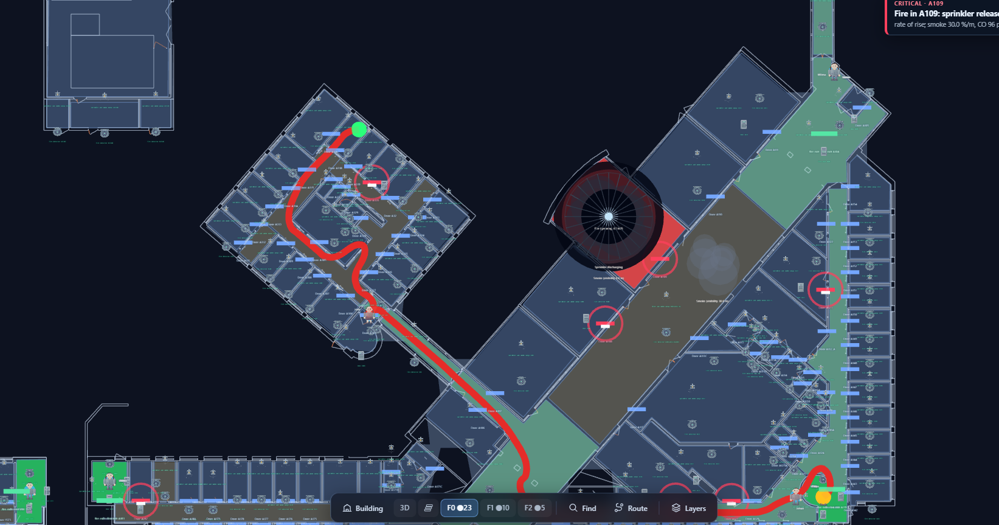
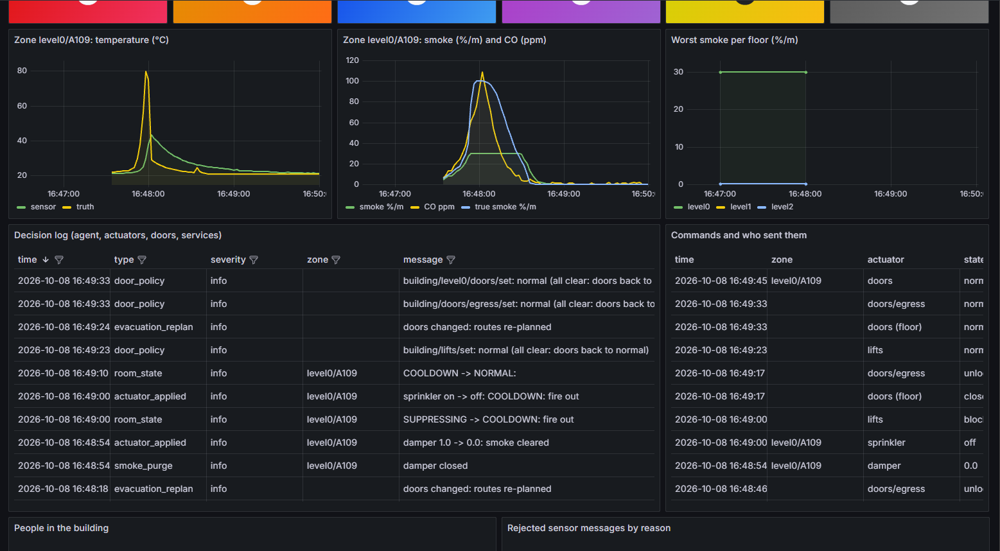

\newpage

# Summary

The system detects fires in every room and corridor of a three-floor
university building, tells real fires apart from cooking, steam, dust,
smoking, heaters and broken sensors, releases the sprinkler only where it
burns, unlocks the access-controlled doors for egress while closing the fire
doors, purges the smoke, predicts which zones the fire will reach next and
evacuates the occupants floor by floor along routes that avoid fire, smoke,
predicted spread and impassable doors. The building, its rooms, doors,
equipment and 3D view are BuildSim's; this project provides the physics, the
devices, the intelligence and the control around it. The thread through every
decision is *a learned model may make the system faster, never less safe*:
fixed, verifiable rules and a 90 °C safety net always stand behind it.

| Field | Value |
|:--|:--|
| Project title | Fire Detection & Evacuation |
| Team members | C. Lisper |
| Use case | Fire detection, suppression, egress and evacuation (956 zones, 3 floors) |
| Repository | https://github.com/Thekingofswords/d7065e-fire-response; services in `devices/`, deployment in `compose.override.yaml` |


**Changes since the proposal.** The proposal's scope was kept: sensors,
one control agent, sprinklers and fire doors, a time-series store, and a
dashboard on the BuildSim 3D view, built one room end to end first and then
grown. The design changed where building and evaluating it showed the
proposal would not work as written. The table compares the two; each change
is explained where it matters below.

| Topic | Proposal | Final system | Why it changed |
|:----|:------|:--------|:----------|
| Detection | An autoencoder trained on normal time series flags anomalies | Fixed rules by default; a LightGBM fire model or a hybrid (isolation forest + autoencoder for anomalies, a classifier for the cause) can be chosen; all behind a 90 °C safety net | Cooking and sensor faults are anomalous too, so an anomaly alone cannot decide on water; rules are verifiable and keep working with broken sensors (SAF-01, NFR-07) |
| Spread | A simple spatial model over the adjacency graph and temperature gradients | A LightGBM model on the same adjacency and gradient features, weighted by how open each door is, with risk kept within three links of an alarm | The simple model could not tell a closed door from an open one; unbounded risk re-planned every route in the live run |
| Physics | Per-room smoke, CO and temperature diffusing along the adjacency graph | A zone fire model: hot and cool layers, corridor cells, door flows and stairwells, fed back by sprinklers, dampers and doors | With plain diffusion smoke never drifted into a neighbour realistically, so telling a fire from smoke next door was trivially easy |
| Doors and actuators | Sprinklers; unlock the nearest fire doors | An access-control schedule locks doors in normal hours and every door is released at an alarm; fire doors *close* (unlocked) to hold smoke; purge dampers and lift recall added | Unlocking only route doors would leave people locked in at night; closing fire doors was the most effective single measure (§11) |
| False alarms | Cooking, dust or sensor faults, small heat sources | Cooking, steam, dust, smoking and heaters, plus device faults (drift, frozen, spikes, dead CO cell, offline) | More look-alikes make the evaluation honest; faults belong to the device, not the room |
| Occupancy and evacuation | Occupants sampled per room by type and time of day, moved to the nearest exit along the recommended route | People with a working day on the building clock; the agent owns the plan (when, which floors, all-clear); the occupants service routes each person with a hazard-weighted planner, cross-checked with BuildSim's route API | Deciding to evacuate is safety-critical, routing one person is not; BuildSim's route API cannot weigh fire or smoke |
| Processes and interfaces | Separate processes with defined interfaces, talking to BuildSim through its API | 14 Docker containers (15 with BuildSim); an MQTT broker with users and an ACL between them; REST only towards BuildSim; separate gateways apply the agent's commands | 956 zones with four consumers per reading suit pub/sub; retained values and last wills give restart and crash detection; deciding is kept apart from acting |


The proposal's two risks were answered. The anomaly model alone *could not*
separate fires from cooking and faults, which is why a cause classifier and
the rules stand behind it. Re-routing speed did not matter at this scale, since one
decision for the whole building takes 0.03 s. Re-routing *too often* was the
real problem, and the live run exposed it.

# Use case and building context (BuildSim)

**The building.** The system protects the BuildSim model of a university
building: three floors, 956 rooms and corridors with sensors, 819 doors and
the walkable graph between them. BuildSim is the *shared state* of the
cyber-physical system. It stores the latest room layers, equipment, doors,
alerts and viewer sessions, exposes a REST API to read and write them, and
streams the 3D view to the browser over WebSocket. It does not simulate
physics, decide anything or keep history. **BuildSim is not modified; it is
instrumented**, which keeps the seam between the physical half (behind
BuildSim's API) and the cyber half (our processes) clean enough that the same
software could drive a real building.

**How the system uses BuildSim.**

* The **fire simulator** is the only process that touches the environment: it
  reads the actuator and door states back from BuildSim every tick
  (`GET /api/equipment?category=fire_suppression`, `GET /api/doors`), advances
  the physics and writes the truth as room layers (`PUT /api/room-layers`) and
  visual effects.
* The **sensor gateways** (one per floor) read those layers, add the
  behaviour of real detectors (lag, noise, faults) and publish readings to
  the broker. They emulate devices; they never create the environment.
* The **actuator gateway** and the **door gateway** apply the agent's
  commands to BuildSim (`PUT /api/actuators/{id}/state`, `PUT /api/doors`) and
  confirm only what BuildSim accepted. The control loop therefore closes
  *through* BuildSim: fire → layers → sensors → agent → actuator → BuildSim →
  fire.
* The **occupants** service and the **display bridge** use BuildSim's
  entities, session highlights, routes and coverage zones to show the people,
  the hazard colours and the smoke in the viewer.
* The **dashboard** is BuildSim's own 3D viewer, which rides BuildSim's
  WebSocket. Every accepted REST write (a layer, a sensor value, a sprinkler
  or door state, a highlight, an alert) is pushed to the browser without
  polling, so the system needs no web server of its own; Grafana adds the
  history BuildSim does not keep.

**Actors.** The *building manager* watches the BuildSim viewer and Grafana
and may command an actuator or a door by hand (the agent adopts a sprinkler it
did not start). *Occupants* follow a daily schedule; they are sensed (presence,
CO₂) and evacuated, but are not on the control path.

**The scenario the demo shows.** At 10:00 on a Monday, a waste-paper basket
smoulders in office A109 for two minutes and then flames as a fast t² fire;
half of the doors stand open and 38 people are in the building. Without the
system A109 flashes over after about five minutes and smoke fills the
corridor and, through the stairwell, the floor above. With it, the smoke
alarm in A109 releases the access control, closes the floor's fire doors and
starts the evacuation of all three floors; about 30 s after flaming begins
the heat detector's rate of rise, confirmed by CO, releases the A109
sprinkler and the fire dies within a minute. The corridor never exceeds
0.5 %/m of smoke (44 %/m with the doors left as they were), the purge damper
clears A109, and the agent gives the all-clear. At night the same alarm
unlocks the more than 500 office and stairwell doors the schedule had locked.

**Why it matters.** Most fire deaths are caused by smoke, not flames, and a
fire grows from a basket to flashover in minutes. Detection must be fast,
must not flood a building with water for every burnt toast (false releases
are expensive and erode trust), must survive a broken sensor in exactly the
room that burns, and must get people out through doors that are locked for
security the rest of the time. Those four concerns, *speed, discrimination,
resilience and egress*, drive the requirements in Section 3.

# Requirements

Each requirement is testable and has a unique ID, a type, a priority, a
measurable acceptance criterion and the test or experiment that verifies it.
Section 10 closes the thread by naming, for every requirement, the design
element that satisfies it and the evidence collected. Functional requirements
(FR) say what the system does. Non-functional requirements say how well; they
are grouped as NFR (performance, resilience, data), SEC (security) and SAF
(safety). The regulatory requirement (REG) is an external rule for escape
doors. Times are simulated seconds unless stated; the simulation runs at 5×
real time.

| ID | Type | Requirement | Prio. | Acceptance criterion | Verified by |
|:--|:--|:-------|:-|:--------|:------|
| FR-01 | Functional | Release the sprinkler in a zone with a flaming fire | Must | ≥ 95 % of fires released ≤ 60 s after flaming | `baseline.py`; `test_fire_is_detected_and_suppressed_through_buildsim` |
| FR-02 | Functional | No release where there is no fire (nuisances, smoke from next door, faulty sensors) | Must | ≤ 1 false release per 100 zone-hours | `baseline.py`; `train_model.py`; `test_hot_smoke_from_next_door_is_attributed_not_released` |
| FR-03 | Functional | Stop the water once the fire is out | Must | After ≥ 300 s of water, once ≤ 35 °C and not heating | `test_sprinkler_runs_its_minimum_time_then_stops_when_cool` |
| FR-04 | Functional | Purge smoke from every zone it reaches | Should | Damper opens ≥ 3 %/m, closes ≤ 0.5 %/m; < 1 %/m within 15 min of suppression | `test_smoke_purge_*`, `response.py` |
| FR-05 | Functional | Alert the building manager | Must | One alert per zone in alarm or suppression, most severe first, ≤ 100; one per offline gateway | e2e fire and gateway-crash tests |
| FR-06 | Functional | Route occupants out avoiding fire, smoke and impassable doors | Should | Detour where an alternative exists; re-plan on a jammed or locked door | `test_jammed_door_makes_the_evacuation_replan` |
| FR-07 | Functional | Close fire doors on an alarm, recall lifts on a fire | Should | Within one tick; closed but unlocked; normal 120 s after the last alarm | `test_fire_alarm_closes_doors_and_recalls_lifts` |
| FR-08 | Functional | Enforce door safety rules whoever commands | Must | Exits never locked or blocked; jammed doors not operable; unknown sources refused | `test_door_rules_are_enforced` |
| FR-09 | Functional | Realistic occupancy over the day | Should | Arrivals 07–09, lunch dip, departures 16–18, empty nights and weekends | `test_schedule.py` |
| FR-10 | Functional | Unlock access-controlled doors for egress on any alarm | Must | Out of hours > 85 % of locked doors released within one tick; exits never locked | `test_fire_alarm_unlocks_egress_doors`, live Run B |
| FR-11 | Functional | Detect anomalies against normal behaviour; classify the cause | Should | ≥ 98 % of fires and nuisances anomalous ≤ 60 s; ≤ 1 false anomaly / 100 zone-h; non-fire anomaly → "check zone", no water | `train_anomaly.py`, `test_anomaly.py`, live Run C |
| FR-12 | Functional | Predict fire spread | Should | AUC ≥ 0.85 and better than the neighbour baseline on held-out data | `train_spread.py`, `test_spread.py` |
| FR-13 | Functional | The agent orchestrates the evacuation | Should | One versioned plan per change; phased floors never shrink; all-clear only from the agent | `test_plan_is_phased_*`, `test_agent_plan_drives_the_evacuation` |
| FR-14 | Functional | Dashboard as specified | Should | Red fire, orange risk/smoke, green safe; smoke coverage; route; every update accepted by BuildSim | `test_dashboard_highlights_and_coverage`, live Run A |
| FR-15 | Functional | Evacuation routes consistent with BuildSim's route API | Should | Without hazards, local and BuildSim routes agree within 5 % | `test_routes_agree_with_buildsims_route_api` |
| NFR-01 | Non-functional | Decide for the whole building every tick | Must | Agent step ≤ 0.5 s for 956 zones (interval 2 s) | `scaling.py` |
| NFR-02 | Non-functional | Survive a sensor-gateway crash | Must | Offline alert ≤ 30 s; readings back ≤ 30 s after restart | e2e crash test, live Run A |
| NFR-03 | Non-functional | Survive an agent restart without stopping water | Must | A running sprinkler stays on | `test_agent_restart_keeps_a_running_sprinkler_on` |
| NFR-04 | Non-functional | Survive a BuildSim restart | Must | Equipment, states and doors restored ≤ 30 s | `test_buildsim_restart_is_recovered`, live Run A |
| NFR-05 | Non-functional | Never act on corrupt data | Must | Malformed, non-numeric, impossible, future, duplicate readings rejected and reported | `test_messages.py`, e2e corrupt-data test |
| NFR-06 | Non-functional | Apply commands quickly | Should | Command → applied and confirmed ≤ 1 s (p90) | `latency.py` (live) |
| NFR-07 | Non-functional | Detect a fire with a broken sensor in the fire room | Should | Frozen or offline thermometer: fire still released, no flashover | `baseline.py --faults` |
| NFR-08 | Non-functional | Degrade safely on bad inputs | Must | Degraded ≤ 10 s, critical alert, never switch water off, recover automatically | `test_degraded_mode`, live Run A |
| NFR-09 | Non-functional | Stop cleanly, restart when hung | Should | SIGTERM → "offline" published; hung 120 s → exit and restart | `test_graceful_shutdown`, `test_lifecycle.py` |
| NFR-10 | Non-functional | Keep history cheaply | Should | Raw compressed after 1 day, kept 30 days; per-minute aggregate; days archived to Parquet | live Run A (TimescaleDB jobs) |
| NFR-11 | Non-functional | One clock | Should | All services follow `sim/clock`; no jumps or backwards time | `test_clock.py` |
| NFR-12 | Non-functional | Survive a broker outage (network drop) | Must | Every service reconnects by itself; the agent is Degraded while its inputs are stale and never switches water off; readings and Running ≤ 30 s after the broker returns | `test_broker_outage_degrades_and_recovers` |
| SEC-01 | Non-functional | Only authorised services may command | Must | No login refused; a sensor login cannot command a sprinkler | `test_broker_enforces_users_and_acl` |
| SEC-02 | Non-functional | Encrypted broker, secrets outside the repository | Should | Verified TLS; plain MQTT and unknown CA refused; passwords from `.env` | `test_tls.py`, live Run D |
| SAF-01 | Non-functional | A learned model is never the only thing between a fire and water | Must | A healthy thermometer at ≥ 90 °C releases regardless of detector | `test_safety_net_releases_even_when_the_detector_says_no` |
| REG-01 | Regulatory | Escape doors must be usable in a fire: doors on escape routes open in the direction of escape without a key, and electrically locked doors are released by the fire alarm (Boverket's rules for escape doors; SS-EN 13637 for electrically controlled exit systems) | Must | Fire exits are never locked or blocked, whoever commands; on any alarm the access control is released for the office and stairwell doors, and they relock only after the all-clear | `test_door_rules_are_enforced`, `test_fire_alarm_unlocks_egress_doors`, live Run B |

Two tensions run through these requirements. Speed (FR-01) pulls towards
releasing early; discrimination (FR-02) pulls towards waiting for evidence.
Resilience (NFR-07) pulls the same way as speed: a room whose thermometer is
broken must still get water, which costs precautionary releases. Resolving
these safely is the autonomous service's whole job (Section 7), and it is
why neither a single threshold nor a learned model alone is enough.

**Traceability.** The five viewpoints map onto the document: context (4.1),
functional (4.2–4.4), information (5–7), behavioural (8) and deployment (9).
Section 10 closes the requirement → design → validation thread.

# Architecture

## Context diagram (C4 Level 1)

The context view fixes the system boundary: the fire detection and
evacuation system is mine to build, and everything around it is outside it.
The system reads and commands the building only through BuildSim. Each
external element in one sentence:

* **Building manager** (person): watches the BuildSim viewer and Grafana,
  receives the alerts, and may command a sprinkler, a damper or a door by
  hand over MQTT (the agent adopts a sprinkler it did not start).
* **Occupants** (people): are sensed (presence and CO₂ through BuildSim's
  entities) and evacuated along the routes shown, but never connect to the
  system and are not on the control path.
* **BuildSim** (provided software system): holds the building model and the
  shared state, answers REST calls and streams the 3D view over WebSocket;
  it is instrumented, not modified.
* **Offline training** (optional software system): generates scenarios and
  trains the fire, anomaly and spread models, then hands over model files; it
  is never on the control path and could run on external compute.

{width=82%}

## Container diagram (C4 Level 2)

Every box is one service in `compose.override.yaml` (BuildSim's own service
is in `compose.yaml`) and one entry-point file in `devices/`; the occupants
service is `examples/api/scenario/populate_evacuation.py`. The services share
one Python package and one image, which is a deliberate decision (4.4). The
optional profiles are not drawn: `csv-recorder` (CSV instead of the
database) and `tests`/`test-broker` (the test suite). The diagrams are code
(Graphviz and Mermaid) in `docs/report/draft/diagrams/`, next to the source,
so they are versioned with it. The arrows carry the protocol. The fire simulator interacts only with
BuildSim and the broker; the sensor gateways read what it wrote; the agent
decides; the gateways apply its commands to BuildSim; the simulator reads
them back next tick, which is the closed loop that makes this a
cyber-physical system rather than a dashboard.

{width=100%}

## Component responsibilities

Every container has one job, which is what makes it testable and lets one part
fail without taking the rest down. The last column is the systems reasoning:
why the job is not merged into a neighbour. Each container is listed by its
service name in `compose.override.yaml`, followed by the name Docker gives the
running container (`docker compose ps`). Compose builds that name as
project–service–index, and the project is the folder name `buildingsim`.
BuildSim itself runs alongside as `buildingsim-buildsim-1`.

| Container (service / Docker name) | Responsibility (one job) | Tech | Reason for separation |
|:------|:--------|:---|:--------|
| **fire-simulator** \newline `buildingsim-fire-simulator-1` | Advance the physics of every active zone; write truth; read actuators and doors back; publish the building clock | Python | It *is* the environment; nothing on the decision side may share its memory |
| **sensor-gateway-level0/1/2** \newline `buildingsim-sensor-gateway-levelN-1` (N = 0, 1, 2) | Turn the environment into realistic, faulty readings for one floor | Python | A crash darkens one floor, not the building; floors scale out independently |
| **mosquitto** \newline `buildingsim-mosquitto-1` | Decouple producers from consumers; retain last values; last wills; enforce who may publish what | Mosquitto 2.0 | One source, many consumers; one place for command authority |
| **building-agent** \newline `buildingsim-building-agent-1` | Detect, decide sprinklers, dampers, doors and lifts; predict spread; own the evacuation plan | Python, LightGBM, scikit-learn | The safety-critical logic, isolated from everything that can fail around it |
| **actuator-gateway** \newline `buildingsim-actuator-gateway-1` | Validate sprinkler and damper commands, apply to BuildSim, then confirm | Python | "Deciding is not acting": a wrong command is rejected independently of the agent |
| **door-gateway** \newline `buildingsim-door-gateway-1` | Own BuildSim's door collection: access schedule, door rules, full snapshot, confirmations | Python | `PUT /api/doors` replaces the collection, so exactly one writer; exit rules hold whoever commands |
| **occupants** \newline `buildingsim-occupants-1` | People with a daily schedule; follow the plan; routes, highlights, progress | Python | Not on the control path; can fail or be left out without affecting fire control |
| **buildsim-bridge** \newline `buildingsim-buildsim-bridge-1` | Register detectors; mirror readings, alerts and smoke coverage into BuildSim | Python | BuildSim takes one request per value; rate limiting and deadbands in one place, off the control path |
| **db-writer** \newline `buildingsim-db-writer-1` | Record readings, labels, commands, states, events, scenarios; set up storage tiers | Python, psycopg | Storage may be slow or down without affecting control |
| **timescaledb** \newline `buildingsim-timescaledb-1` | Hot and warm history, training data, audit trail | PostgreSQL 16 + TimescaleDB | The only durable record; BuildSim keeps nothing |
| **archiver** \newline `buildingsim-archiver-1` | Copy finished days to Parquet (cold tier) | Python, pyarrow | Batch work every 6 h, independent of recording |
| **grafana** \newline `buildingsim-grafana-1` | Time series, status tiles, decision log | Grafana 11 | Presentation, read-only on the database |

## Design decisions and justifications

Each row follows "X because (requirement); the alternative was Y; the trade-off
accepted is Z".

| Decision | Chosen | Alternatives | Justification (requirement) | Trade-off |
|:----|:-----|:----|:----------|:-----|
| Sensor transport | MQTT pub/sub, QoS 0 retained | REST to each consumer; Kafka | Four consumers need every reading; retained values and last wills give restart and crash detection (NFR-02, NFR-03) | A broker to run; at-most-once readings (replaced 2 s later) |
| Loop through BuildSim | Simulator writes layers and reads actuators from BuildSim | Simulator ↔ sensors directly | BuildSim is the shared state; the same software could drive a real building behind the same API | Two REST reads per tick; BuildSim on the critical path (NFR-04) |
| Device granularity | One gateway per floor, one actuator gateway | One process per device | 956 zones × 6 devices would not fit a laptop; real buildings use gateways (NFR-01) | A crash darkens a floor (one alert per gateway) |
| Detection | Rules by default; LightGBM or hybrid optional; all behind a 90 °C safety net | Rules only; deep model; LLM | Rules are verifiable and survive broken sensors (FR-01, NFR-07); models cut false releases and release earlier (FR-02); the safety net bounds model failures (SAF-01) | Models must be retrained when the physics changes |
| Anomaly stage | Isolation forest + autoencoder on normal data; cause by a supervised classifier | One-class SVM; autoencoder only | Two notions of "unusual" (isolation, reconstruction) catch more; scikit-learn only (FR-11) | A second model file, version-pinned |
| Spread prediction | LightGBM on adjacency-aggregated features weighted by door openness | Graph neural network; physics look-ahead | Adjacency plus temperature gradients as asked; milliseconds per tick; explainable (FR-12) | Learns the simulator's physics |
| Features in the agent | `features.py` shared by training and the agent | Pipeline service | No train/serve skew; no extra hop (NFR-01) | ~6 min of history per zone in memory |
| Command reliability | QoS 1 + separate confirmed state + re-send | Fire-and-forget; REST response | The agent acts on what was applied, not what it asked for (FR-01, NFR-06) | Two topics per actuator |
| Physics fidelity | Zone fire model with cells, doors, stairs | Linear diffusion; CFD | Smoke must drift into non-burning rooms realistically, or discrimination is trivial (FR-02) | More parameters; still a simplification |
| Doors | One door gateway owns the snapshot; commands per door, zone, floor, lifts, egress | Each service writes doors | `PUT /api/doors` replaces everything; rules in one place (FR-08, FR-10, REG-01) | Changes batched (≤ 1 s) |
| Fire-door policy | Close (not lock) the alarmed floor's fire doors | Alarmed zone only; lock | Contains smoke before the fire is confirmed (FR-07), keeps every door an escape route (FR-06) | Doors close for nuisance alarms too |
| Evacuation ownership | Agent owns phase, floors, all-clear; occupants route people | Agent routes everyone; occupants decide alone | Deciding to evacuate is safety-critical, routing individuals is not (FR-13) | Two processes must agree (versioned, retained plan) |
| Evacuation routing | Local hazard-weighted Dijkstra, cross-checked with `/api/graph/route` | BuildSim's route API only | BuildSim's route cannot weigh fire, smoke or risk (FR-06, FR-15) | Two route computations to keep consistent |
| Storage | TimescaleDB hot + warm, Parquet cold | Plain PostgreSQL; files only | Fast recent queries and cheap history (NFR-10) | Two places to look |
| Command authority | Mosquitto users + ACL + gateway validation; optional TLS | Shared secret in payloads | Enforced before any consumer sees a message (SEC-01, SEC-02) | Passwords and certificates to manage |
| Lifecycle | Shared `lifecycle.py`: status topic, heartbeat, watchdog | Docker restarts only | A degraded service says so, acts safely and reconnects by itself (NFR-08, NFR-09, NFR-12) | A little code in every service |
| Code layout | One Python package and one image; one entry point and one container per service | One folder and image per service | Validation (`messages.py`), lifecycle and features must be identical in every service, or the agent and training disagree (NFR-05, FR-11); each container is still its own process with its own user and restart policy | A change to a shared module rebuilds every service; the folder does not show the boundaries, so 4.2–4.3 map each container to its file |

# Interfaces and communication

Three patterns are used, each for the job it fits. **Publish–subscribe
(MQTT)** carries readings, commands, confirmations, alerts, the plan and
events between my processes, because one source feeds several consumers and
the broker buffers a briefly absent one; QoS 1 and a separate retained
confirmation topic make commands reliable. **Request–response (REST)** is
used for every call to BuildSim, because each is a question or a state change
whose result the caller must check. **WebSocket** (BuildSim's own) pushes the
3D view to the browser. SQL connects the database to Grafana and the
archiver. Room names are URL-encoded in topics (`A103+A112_B+A103` →
`A103%2BA112_B%2BA103`), since `+` is an MQTT wildcard.

A reading and a command, as they cross the bus:

```json
building/level0/A109/sensors     (QoS 0, retained, every 2 s per zone)
{"ts": 1791468036.2, "gateway": "sensors-level0",
 "temperature": 31.4, "smoke": 9.8, "co": 42.0, "co2": 655.0}

building/level0/A109/actuator/sprinkler/set      (QoS 1, re-sent until confirmed)
{"state": "on", "reason": "SUPPRESSING: rate of rise",
 "id": "9cac88124bbe", "ts": 1791468041.8, "source": "building-agent"}
```

Units: temperature °C (−40…1200), smoke obscuration %/m (0…100), CO and CO₂
ppm (0…10 000 / 100 000), `ts` seconds since the epoch. Every consumer
validates every reading (`messages.py`); anything outside these ranges, not
numeric, more than 60 s in the future or not newer than the last accepted one
is dropped and counted (`data_quality` events).

| Topic | Producer → consumers | Payload | QoS / retain / rate |
|:-----|:----|:---------|:---|
| `building/<lvl>/<room>/sensors` | sensor gateway → agent, db-writer, bridge | ts, gateway, temperature, smoke, co, co2 | 0 / yes / 2 s per zone |
| `…/actuator/<name>/set` | agent, operator → actuator gateway | state (`on`/`off`, damper 0–1), reason, id, source | 1 / no / on change, re-sent 10 s |
| `…/actuator/<name>/state` | actuator gateway → agent, db-writer | state, ts, command_id, reason, source, corrected | 1 / yes / after BuildSim accepted |
| `building/<lvl>/doors/set`, `…/<room>/doors/set`, `building/lifts/set`, `building/doors/egress/set` | agent, occupants, operator → door gateway | state and/or lock_state, reason, id, source | 1 / no / on change |
| `building/doors/<id>/state` | door gateway → agent, occupants, db-writer | state, lock_state, kind, level, room, reason, source | 1 / yes / on change |
| `building/alerts` | agent → bridge | list of {id, severity, title, message, level, room} | 1 / yes / on change |
| `building/risk` | agent → occupants, db-writer | zones {zone: p}, horizon_s 300, model, threshold | 1 / yes / on a new set or 0.1 change |
| `building/evacuation/plan` | agent → occupants, db-writer | phase, evacuate_levels, fire/alarm/smoke/risk zones, exits, doors, version, clock | 1 / yes / on change |
| `building/evacuation/progress` | occupants → agent | present, pre_movement, evacuating, evacuated, awaiting_rescue {zone: n}, route_checks | 1 / yes / 5 s |
| `building/gateways/<name>/status`, `building/services/<name>/status` | every service | status, lifecycle state, detail, since (last will: offline) | 1 / yes / on change |
| `sim/clock`, `sim/scenario` | simulator → all | sim_time, week_minute, "Mon 07:31"; scenario and fault schedule | 0–1 / yes / every tick |
| `sim/truth/<lvl>/<room>` | simulator → db-writer only | true values + labels (training and evaluation only) | 0 / yes |
| `building/events` | all → db-writer | ts, type, severity, level, room, message, … | 1 / no |

The field types of the main payloads (JSON; `float` and `int` are JSON
numbers, times are seconds since the epoch, zone keys are `<level>/<room>`):

| Payload | Fields: type [unit or values] |
|:----|:-----------|
| Reading | `ts` float [s]; `gateway` string; `temperature` float [°C]; `smoke` float [%/m]; `co`, `co2` float [ppm]; every field is required (a reading without one is rejected as `missing`) |
| Actuator command | `state` "on" or "off" (sprinkler), float 0–1 (damper); `reason` string; `id` string (unique, echoed in the confirmation); `ts` float [s]; `source` string (service or operator) |
| Actuator confirmation | `state` as applied; `ts` float [s]; `command_id`, `reason`, `source` string; `corrected` bool (state taken from BuildSim at start-up) |
| Door command | `state` "open", "closed", "blocked" or "normal"; `lock_state` "locked", "unlocked" or "normal" ("normal" returns to the access schedule); `reason`, `id`, `source` string |
| Door state | `state`; `lock_state` (also "jammed"); `kind`, `level`, `room`, `reason`, `source` string |
| Risk | `zones` {zone key: float 0–1}; `horizon_s` int [s] (300); `model` string; `threshold` float; `ts` float [s] |
| Evacuation plan | `phase` "normal", "evacuate" or "all_clear"; `evacuate_levels`, `fire_zones`, `alarm_zones`, `smoke_zones`, `risk_zones`, `exits` lists of strings; `doors` {`egress`, `lifts` string, `closed_levels` list}; `version` int |
| Progress | `phase` string; `plan_version` int; `present`, `pre_movement`, `evacuating`, `evacuated` int [people]; `awaiting_rescue` {zone key: int}; `last_out_s` float [s]; `route_checks` {`checked`, `agree`, `mismatch` int} |
| Status | `status` "online", "degraded" or "offline"; `state` lifecycle state; `detail` string; `since`, `ts` float [s] |

Collection `PUT`s in BuildSim replace everything, so each has exactly one
writer. BuildSim answers `200` with JSON when a write is accepted, `400` when
the body is invalid (a collection `PUT` is then rejected as a whole: one
person off the floor page cost a whole people update in the live run), and
`404` for an unknown id, session or route. Every writer checks the status;
a gateway confirms a state only after a `200`.

| BuildSim endpoint | Sole writer | Readers | On error |
|:------|:----|:-----|:------|
| `PUT /api/room-layers`, `/api/effects` | fire-simulator | sensor gateways, viewer | Re-sent next tick |
| `POST /api/equipment/bulk`, `PUT /api/sensors/{id}/value`, `PUT /api/alerts`, `PUT /api/coverage` | buildsim-bridge (≤ 150 requests/s, deadbanded) | viewer | `404`: re-register the equipment (BuildSim restarted) |
| `POST /api/equipment/bulk` (`fire_suppression-…`), `PUT /api/actuators/{id}/state` | actuator-gateway | fire-simulator (`GET /api/equipment`), viewer | `404`: re-register; otherwise Degraded; never confirmed, so the agent re-sends |
| `PUT /api/doors` (full snapshot); `door_lock` equipment | door-gateway | fire-simulator, occupants, BuildSim's own routing, viewer | Degraded; snapshot re-sent; confirmations held until a `200` |
| `PUT /api/entities`, `/api/occupancy`, `/api/sessions/{id}/highlights`, `…/route` | occupants | sensor gateways (people for CO₂), viewer | Logged; positions kept on the floor page |
| `GET /api/graph/route` | (read only) | occupants (route cross-check) | `404` (no path): counted as a mismatch |

Every decision message carries a human-readable *reason*
(`"rate of rise; smoke 30.0 %/m, CO 96 ppm"`), so every action is auditable
afterwards, in the alert list and in Grafana's decision log.

# Simulating the sensor values (the physical model)

BuildSim provides the rooms but not their physics, so a **zone fire model**
was built from standard fire-engineering correlations. The aim is not CFD
accuracy but enough realism that the detection problem exists: heat, smoke
and CO must rise in the right order, drift into rooms that are not burning,
get thinner with every doorway and respond to sprinklers, dampers and doors.
Each *cell* (a room, or a ~4 m segment of a corridor along its walkable graph)
has a hot upper layer and a cool lower layer; only active cells are
integrated, so a quiet building costs almost nothing.

**Fire.** After an optional smouldering phase (little heat, smoky and CO-rich),
the heat release grows as a t² fire, capped by the fuel and by the air the
openings let in (Kawagoe):
$$\dot Q(t) = \min\!\big(\alpha t^2,\; q''A_{\mathrm{floor}},\; 1500\,A_o\sqrt{H_o}\big)\ \mathrm{kW},$$
with $\alpha$ from the SFPE growth classes, $q'' = 250$ kW/m² and $A_o, H_o$
the open area and height of the doorways. Flashover occurs at a 600 °C layer;
after 70 % of the fuel load the fire decays.

**Heat.** The hot-layer temperature follows the MQH correlation with a
thermal lag, and the detector sees the Alpert ceiling jet on top:
$$\Delta T_{\mathrm{MQH}} = 6.85\left(\frac{\dot Q^2}{A_o\sqrt{H_o}\,h_k A_T}\right)^{1/3},\qquad
\Delta T_{\mathrm{jet}} = \begin{cases}16.9\,\dot Q^{2/3}/H^{5/3} & r/H \le 0.18\\ 5.38\,(\dot Q/r)^{2/3}/H & \text{otherwise.}\end{cases}$$

**Smoke and gases.** A Heskestad plume, $\dot m = 0.071\,\dot Q_c^{1/3} z^{5/3}$,
fills the ceiling layer, which descends. Soot, CO and CO₂ yields per kilogram
of fuel rise when the fire is short of air; soot becomes obscuration through
the specific extinction coefficient (8.7 m²/g flaming, 4.4 m²/g
smouldering). Once the layer is below a door soffit it spills through the
door as a buoyant flow,
$$\dot V = \frac{C_d}{3}\,w\,h\,\sqrt{\frac{g\,h\,\Delta T}{T_{\mathrm{cold}}}},\qquad C_d = 0.7,$$
entraining room air on the way, so smoke is cooler and thinner after every
doorway. Closed doors leak 1 % of their area; stairwells carry hot smoke up
with a stack flow; background ventilation (2 ACH), soot settling and the
purge damper (10 ACH when open) remove it. Sprinklers make the heat release
decay as $e^{-t/43\,\mathrm{s}}$ (NIST), much less effectively after flashover,
and do not remove smoke; switching the water off early lets the fire regrow.

**Look-alikes.** Cooking (smoke, some heat, a little CO), steam (dense aerosol,
no CO), dust (short burst), heaters (heat only) and smoking (light smoke with
CO) create the false-alarm cases the detectors must reject.

**Sensors.** The gateways model real devices: a heat element with a response
time index, $\mathrm{d}T_d/\mathrm{d}t = \sqrt{u}\,(T_g - T_d)/\mathrm{RTI}$
(RTI 50, $u$ the ceiling-jet velocity); a photoelectric chamber that smoke
must drift into (lag $L/u$); first-order CO and CO₂ cells; noise, resolution
and range. Faults belong to the device: a drifting smoke chamber, a frozen
thermometer, smoke spikes, a dead CO cell, or a device that stops reporting.

**Occupancy.** People are agents with a working day on the building clock:
an office each, arrival around 08:00 through an entrance (normally
distributed, $\sigma$ = 30 min, between 07:00 and 09:30), lunch starting between
11:30 and 12:30 for 30–60 min (half in the floor's lunch room, half out),
visits to meeting rooms and colleagues along BuildSim's walkable graph,
departure between 16:00 and 18:00, nights and weekends empty. Every person
draws a new plan each day, so no two days are alike. Room types come from the
floor plan (rooms ≥ 25 m² are meeting rooms, the largest per floor is the
lunch room). People are BuildSim entities, so the sensor gateways count them
and add their CO₂ with a well-mixed room balance,
$$\frac{\mathrm{d}C}{\mathrm{d}t} = \frac{g\,n\cdot 10^6}{V} - \frac{Q}{V}\,C,\qquad g = 5.2\cdot10^{-6}\ \mathrm{m^3/s\ per\ person},$$
with $n$ people, room volume $V$ and ventilation flow $Q$ (2 ACH), on top of
the fire's CO₂. The occupants are also the population the evacuation must
move.

**The loop closes through BuildSim.** The simulator reads the sprinkler,
damper and door states back from BuildSim every tick: water makes the heat
release decay, an open damper drains smoke, a closed door leaks only 1 %.
That is why the evaluation in Section 11 can compare policies on the same
fire. The model's limitations (well-mixed cells, no wind or HVAC network,
fuel per floor area rather than per object) are listed in Section 13.

# Autonomous services and data engineering

## The autonomous service

One agent decides for the whole building every 2 s. A building-level agent is
needed because the decisive evidence is often next door: a rate of rise in a
room whose neighbour is hotter and heat-alarmed is smoke spilling in, not a
fire, which a per-room device cannot know.

{width=78%}

**Detectors** (`DETECTOR=rules|model|hybrid`).

* *Rules*: smoke ≥ 8 %/m or CO ≥ 50 ppm raises the alarm; ≥ 68 °C, or a rise
  ≥ 8.3 °C/min with evidence of combustion (CO ≥ 10 ppm, a rise ≥ 16.6 °C/min,
  or ≥ 50 °C), releases water, unless a neighbour is hotter and heat-alarmed.
  Without a working thermometer, dense smoke plus CO releases.
* *Model*: a LightGBM fire probability from 51 features: own signals, rates
  over 30/60/120/300 s, excess over baseline, maxima, spread, CO per smoke,
  neighbour maxima and differences, sensor-health flags and a corridor flag.
  The release threshold (0.85) is the most sensitive one within 1 false
  release per 100 zone-hours on validation scenarios.
* *Hybrid*: the rules, plus an anomaly stage and a cause stage (7.2). An
  anomaly classified as fire raises the alarm and releases at P(fire) ≥ 0.98;
  any other anomaly gives a "Check zone" alert, never water. The rules'
  decisions always stand.

**Why rules are the default.** The simplest approach that meets the
requirement wins: rules meet FR-01 and FR-02 in the closed loop, survive
broken sensors through explicit fallbacks, and every decision can be
explained in one sentence. The learned detectors release earlier, and the
hybrid cuts smoke exposure by 40 % (Section 11), so they are offered behind
the same safety net, by choice.

**Latency budget, inputs, actions, integration.** The agent has a 2 s tick
and a 0.5 s budget for the whole building (NFR-01). One decision for all 956
zones takes 0.03 s with the rules and 0.04 s with the LightGBM model,
measured by `scaling.py`. The models therefore run in-process, with no network
hop on the safety path. Inputs are the validated readings
(`building/+/+/sensors`), the confirmed actuator and door states, gateway
status, the building clock and the occupants' progress. Outputs are sprinkler
and damper commands, door commands (egress, floor fire doors, lifts),
alerts, the risk map, the evacuation plan and an event with a reason for
every change. The agent is evaluated offline on 150 closed-loop scenarios
and the held-out model metrics, end to end through the fake BuildSim, and
live (Sections 10–11).

**Policy.** A per-zone state machine (Section 8.3) with two-tick debouncing:
the sprinkler runs at least 300 s and stops once the zone is ≤ 35 °C and not
heating; the purge damper opens at 3 %/m and closes below 0.5 %/m. On any
alarm the agent releases the access control (`building/doors/egress/set`),
closes the floor's fire doors (closed, unlocked) and starts the plan; on a
confirmed fire it recalls the lifts.

**Spread prediction and the evacuation plan.** Each tick the spread model
estimates, per zone, the probability of becoming untenable (burning, ≥ 60 °C
or ≥ 10 %/m) within 300 s; risk is reported within three links of an alarm.
The plan goes `normal → evacuate → all_clear`: the alarm floor and the floors
above first, every floor on a confirmed fire or after 300 s, never fewer
during one evacuation, all-clear 180 s after the last alarm. Occupants report
progress back; people sheltering or trapped become a critical alert.

**Failure and safety behaviour.** A healthy thermometer at ≥ 90 °C releases
whatever the detector says (SAF-01). A faulty thermometer can never declare a
fire out (frozen readings look cool and steady): the agent uses falling CO and
smoke and doubles the minimum discharge. A zone whose fire sensors are all
faulty gets water as a precaution when a neighbour shows ≥ 2 %/m smoke or
≥ 15 ppm CO, because closed fire doors otherwise hide its fire until it
flashes over (found by `baseline.py --faults`). In *Degraded* mode (a gateway
offline or > 20 % of zones stale) water is never switched off. After a
restart the agent adopts any sprinkler that is confirmed running; if the
model files cannot be loaded, it falls back to the rules.

## The learned models

All three are trained offline on scenarios generated by the same physics,
sensors and agent policy as the live system (`generate_dataset.py`, 1,250
random scenarios, ~2.1 million zone-ticks), split *by scenario* 70/15/15 so
neighbouring rows of one fire never leak between training and test.

* **Fire model** (`train_model.py`): binary LightGBM; held-out: 90 % of
  burning zones released, p90 20 s after flaming, 0.97 false releases per
  100 zone-hours.
* **Anomaly detection** (`train_anomaly.py`, `anomaly.py`): an isolation forest
  and an MLP autoencoder (38 → 16 → 8 → 16 → 38) trained on *normal* periods
  only (before anything happens in a scenario). Each score is divided by its
  own threshold, set on validation normal data for ≤ 1 false anomaly per 100
  zone-hours; the anomaly score is the larger. A four-class LightGBM (normal,
  fire, nuisance, fault) on the 51 features plus the anomaly score names the
  cause.
* **Spread model** (`train_spread.py`, `spread_model.py`): LightGBM on 20
  features aggregated over the adjacency graph: own temperature, rate, smoke
  and CO; per neighbour the temperature gradient and smoke, weighted by how
  open the connection is (open door 1, stairwell 0.5, closed door 0.03, from
  the door gateway's confirmed states); neighbouring fire and alarm; graph
  distance to the nearest fire. Labels come from each zone's future in 800
  closed-loop scenarios. Baseline: "next to a fire or a markedly hotter zone".

## The data pipeline

{width=100%}

**Ingestion.** The broker is the buffer: if the database is slow, db-writer
falls behind and catches up; control is unaffected. Quiet zones are recorded
every fifth tick, busy ones every tick (≈ 450 rows per 2 s during a fire).
The simulator's truth labels are joined into the same rows, so live
recordings and generated data share one schema. **Storage.** TimescaleDB's
`samples` hypertable is the hot tier (compressed after a day, kept 30 days),
the `samples_1m` continuous aggregate the warm tier (Grafana's floor panels),
and Parquet files per day the cold tier for training and analysis (DuckDB,
pandas). **Features.** `features.py` computes rates, baselines, spreads and
neighbour context, the same code in training and in the agent, so there is no
train/serve skew. **Data quality** is treated as a control input, not
hygiene: corrupt, impossible, future and duplicate readings are rejected at
every consumer and reported; a sensor whose BuildSim timestamp is older than
20 s is *offline*; a reading that has not changed for 180 s is *frozen*
(working sensors always jitter); faulty signals are blanked before the
detectors see them, and the model was trained with the matching `_ok` flags.

# Behaviour

## Key scenario, dynamic diagram

The demo fire from Section 2, as the containers collaborate at runtime. The
diagram exposes what the static views hide: the doors and the evacuation start
at the *smoke alarm*, minutes before the fire is confirmed, and the sprinkler
command is only "done" when the actuator gateway confirms that BuildSim
accepted it.

{width=100%}

## Process lifecycle, state machine

Every service runs the same lifecycle (`lifecycle.py`), published retained on
its status topic and as `service_state` events. *Degraded* is where the fault
handling lives: the agent keeps every running sprinkler on and raises a
critical alert; a sensor gateway that cannot read BuildSim stops publishing
(rather than sending stale values with fresh timestamps), so the agent sees
those zones offline. A heartbeat file feeds the Docker health check (30 s); a
watchdog exits a hung process after 120 s so the restart policy restarts it;
a crash is announced by the broker through the last will.

**When the network drops.** If the connection to the broker is lost, each
service's MQTT client reconnects every 1–10 s by itself, re-subscribes and
re-publishes its status. QoS 1 commands wait in the client's queue and are
delivered on reconnect. Meanwhile the broker's last will reports the service
offline. The agent receives no fresh readings, so after 20 s (more than
20 % of the zones stale) it goes Degraded and keeps every running sprinkler
on. Once readings flow again it returns to Running. The fault-injection test
kills the broker for 15 s and restarts it without its retained state:
readings from every floor were back 11.5 s, and the agent was Running 12.0 s,
after the restart (NFR-12). Losing BuildSim instead of the broker leads to
the same Degraded state, recovered the same way (NFR-04).

{width=100%}

## Zone state machine

Each zone's state in the agent. Every transition is code; the conditions are
debounced over two ticks, and suppression can only end through COOLDOWN.

{width=100%}

# Deployment and component placement

{width=92%}

Everything runs as containers on one laptop, so deployment is about how the
system is composed. **Fault isolation**: physics, devices, decisions,
actuation, display, people and storage fail independently; if the bridge,
Grafana or the database dies, detection and suppression continue; if a sensor
gateway dies, one floor goes dark and is alarmed by its neighbours; if the
agent dies, sprinklers hold their state and the retained plan keeps the
evacuation going. **Resources**: the simulator and the agent need CPU, the
database disk, the bridge is limited by BuildSim's request rate, not CPU.
**Exposure**: only BuildSim (9090), the broker (1883, or 8883 with TLS), the
database (5433) and Grafana (3000) are published, all on loopback; secrets
come from `.env`; models are mounted read-only. **What merging would lose**:
merging the actuator gateway into the agent would remove the independent
check on commands; merging the gateways would turn one floor's crash into a
building-wide blackout; merging db-writer into the agent would make a slow
disk delay a sprinkler. **Edge–cloud**: in a real building the broker,
gateways, agent and actuator gateways belong on an edge server in the
building, so the loop survives an internet outage; data generation and
training (minutes of CPU, off the critical path) could run in the cloud and
deliver model files.

**Latency.** Every hop is on one host, over Docker's bridge network. A
broker hop costs well under a millisecond, and a sprinkler command is
applied and confirmed in ≤ 0.01 s. The slow links are BuildSim's REST API
(the door snapshot is batched to one `PUT` per second, so doors take ~1 s)
and the tick itself (2 s), not the network. **Maintainability and
operations**: one image and one `docker compose up` start everything;
configuration is environment variables with defaults, and secrets live in
`.env`; every container has a health check, a restart policy and a status
topic; logs go to `docker compose logs`, and Grafana's decision log explains
what happened. A new floor is one more sensor-gateway service with
`GATEWAY_LEVELS` set.

# Test plan

Tests run at three levels. There are 98 unit tests (physics, sensors,
health, features, agent logic, doors, plan, spread, anomaly, clock, schedule,
evacuation). There are 22 end-to-end and fault-injection tests that start a
real Mosquitto broker with the production users and ACL, a fake BuildSim that
validates like the real one (doors, coverage, highlights), and every service
as a real process; they kill processes, stop BuildSim and the broker, and send
corrupt data. Finally, the full Docker stack ran live on the real BuildSim
(Runs A–D, Section 11). All 120 tests pass locally (12 October).
`docker compose --profile test run --rm tests` runs the suite in Docker: 116
passed on 8 October, with the 3 TLS tests skipped there for lack of a broker
in the image (they pass locally, and TLS was verified in Run D). The
broker-outage test was added afterwards; it needs a broker it can restart, so
it runs locally and is skipped in Docker. Every requirement below names the
design element that satisfies it and the evidence that verifies it, which
closes the requirement → design → validation thread.

| Requirement | Satisfied by (design) | Test approach | Evidence |
|:---|:-------|:-------|:-------|
| FR-01, FR-03 | Detectors and zone policy (§7.1); actuator gateway (§4.3) | Closed loop through the fake BuildSim; 150 random scenarios offline; live demo fire | e2e: released and fire decaying (≤ 102 simulated s after flaming, an upper bound measured from the test start); `results/baseline`; live: 29 simulated s |
| FR-02 | Neighbour attribution and combustion evidence in the rules; model thresholds (§7.1) | Nuisances, neighbouring fires and faults in 150 scenarios; held-out event metrics | False releases per policy (§11) |
| FR-04, FR-07 | Purge and fire-door policy (§7.1); door gateway (§4.3) | Demo fire with and without fire doors | Corridor smoke over time (§11) |
| FR-05 | Agent alerts, mirrored by the bridge (§5, §12) | e2e fire and gateway crash | Fire alert and gateway-offline alert (1.5 s), cleared after recovery |
| FR-06, FR-15 | Occupants service, hazard-weighted planner cross-checked with BuildSim (§4.4) | Jam a door during an evacuation; compare routes with BuildSim | `evacuation_replan` events; `route_check` 15 of 15 agree |
| FR-08, REG-01 | Door gateway rules and access schedule (§4.3) | Commands that would lock an exit, open a locked door or operate a jammed one | `door_command_rejected` events; exits never locked |
| FR-09 | Daily schedule in the occupants service (§6) | Schedule unit tests: a weekday profile and a weekend | Arrivals, lunch dip, departures, empty weekend (`test_schedule.py`) |
| FR-10, REG-01 | Agent egress release, door gateway (§7.1) | Night-time clock, fire alarm (e2e and live) | 726 doors unlocked (e2e); live Run B screenshots before and after |
| FR-11, FR-12 | Anomaly, cause and spread models (§7.2) | Held-out scenarios; hybrid live | `results/anomaly`, `results/spread`; live Run C log |
| FR-13, FR-14 | Evacuation plan (§7.1); dashboard (§12) | Plan phasing unit tests; e2e plan, highlights and coverage | Plan versions; no rejected BuildSim update; live screenshots |
| NFR-01 | In-process detectors, shared features (§4.4) | Agent step for 1×–16× the building | Latency-vs-zones curve (§11) |
| NFR-02, NFR-04, NFR-08 | Lifecycle, last wills, Degraded mode (§8.2) | `kill -9` a gateway; restart BuildSim; two gateways offline | e2e: readings back 0.5 s after the gateway restart, BuildSim state restored in 1.0 s; live: 14 s median, Degraded then Running |
| NFR-03 | Retained confirmations, sprinkler adoption (§7.1) | Restart the agent during suppression; stale retained "on" | Sprinkler adopted in 5.5 s; stale state corrected |
| NFR-05 | `messages.py` validation at every consumer (§7.3) | Malformed, NaN, out-of-range, future, duplicate messages | `data_quality` counts (7 of 7 rejected) |
| NFR-06 | QoS 1 commands with separate confirmations (§4.4, §5) | Live run, database timestamps | `latency.py` (§11) |
| NFR-07 | Sensor health, fallbacks, blind-zone rule (§7.1) | 60 fires with a frozen or offline fire-room thermometer | `results/faults` |
| NFR-09 | Lifecycle and watchdog (§8.2) | SIGTERM; hung loop | "offline" published; watchdog exit |
| NFR-10 | TimescaleDB tiers and archiver (§7.3) | Live run on TimescaleDB | Compression, retention and aggregate jobs listed |
| NFR-11 | Building clock on `sim/clock` (§5) | Clock unit tests (follower, fallback, no jumps); e2e plan on the shared clock | `test_clock.py`, `test_agent_plan_drives_the_evacuation` |
| NFR-12 | MQTT client reconnect, lifecycle (§8.2) | Kill the broker for 15 s and restart it without its retained state | Readings from every floor 11.5 s and agent Running 12.0 s after the restart |
| SEC-01, SEC-02 | Broker users, ACL, optional TLS (§4.4, §9) | No login; wrong user; TLS with an unknown CA; plain MQTT on 8883 | Refused connections and publishes |
| SAF-01 | 90 °C safety net (§7.1) | 90 °C with the detector saying "no" | Release in the unit test |

# Evaluation and experiments

The system was evaluated offline on the same physics, sensors and policy as the
live services (`experiments/`), and live on the real BuildSim. The point of
this section is evidence, including where the design fails.

**One fire over time (FR-04, FR-07).** The demo fire in A109, smoke in the
corridor outside it. Without the system the room flashes over and the corridor
fills completely. The rules agent releases the sprinkler 30 s after flaming;
with the doors left as they were the corridor still peaks at 44 %/m and is
clear after 890 s; with the fire-door policy the doors close at the smoke alarm
and the corridor never exceeds 0.5 %/m, clear after 350 s. Closing doors
early does more for the corridor than the sprinkler does.

\begin{figure}[H]
\centering
\begin{tikzpicture}
\begin{axis}[width=0.92\textwidth, height=6.2cm, xlabel={Simulated time (s)}, ylabel={Corridor smoke (\%/m)},
  xmin=0, xmax=1800, ymin=0, ymax=105, grid=major, grid style={gray!25},
  legend pos=north east, legend style={font=\small, draw=none, fill=white, fill opacity=0.85}, tick label style={font=\small}]
\addplot[color=orange!85!black, thick] table[x=time, y=none_smoke, col sep=comma] {data/corridor.csv};
\addlegendentry{No system}
\addplot[color=blue!60, thick, dashed] table[x=time, y=rules_no_doors_smoke, col sep=comma] {data/corridor.csv};
\addlegendentry{Rules agent, doors as they were}
\addplot[color=blue!80!black, very thick] table[x=time, y=rules_smoke, col sep=comma] {data/corridor.csv};
\addlegendentry{Rules agent + fire doors}
\addplot[color=gray, dashed, domain=0:1800] {10};
\addlegendentry{10 \%/m (untenable)}
\end{axis}
\end{tikzpicture}
\caption{Corridor smoke outside A109 during the demo fire (same fire, three policies). Without the system the corridor fills completely; the rules agent with the doors left as they were peaks at 44 \%/m; with the fire-door policy the doors close at the smoke alarm and the corridor stays below 0.5 \%/m. The dashed line marks 10 \%/m, where a corridor becomes untenable.}
\end{figure}

**Many fires (FR-01, FR-02).** 150 random scenarios (72 fires, nuisances,
quiet periods, faults), every policy on exactly the same scenario.

| Policy | Fires released | Release after flaming, median / p90 | Flashovers | Smoke, zone-min > 10 %/m | False releases (≈ 970 zone-h) |
|:--|:-:|:-:|:-:|:-:|:-:|
| No system | 0 / 72 | – | 13 | 17,770 | 0 |
| Rules, doors as they were | 70 / 72 | 37 / 45 s | 0 | 6,394 | 2 |
| Rules + fire doors | 70 / 72 | 34 / 44 s | 0 | 2,542 | 1 (0.1 / 100 zone-h) ✓ |
| LightGBM model + fire doors | 72 / 72 | −172 / 19 s | 0 | 2,223 | 4 (0.4) ✓ |
| Hybrid + fire doors | 72 / 72 | −171 / 31 s | 0 | 1,503 | 2 (0.2) ✓ |

\begin{figure}[H]
\centering
\begin{tikzpicture}
\begin{axis}[ybar, width=0.85\textwidth, height=5.4cm, bar width=22pt, ymin=0, ymax=20500,
  ylabel={Zone-min above 10 \%/m}, symbolic x coords={None, Rules (doors as were), Rules + doors, Model + doors, Hybrid + doors},
  xtick=data, x tick label style={font=\footnotesize, text width=2.2cm, align=center}, nodes near coords, nodes near coords style={font=\footnotesize},
  grid=major, grid style={gray!25}, enlarge x limits=0.12, scaled y ticks=false, yticklabel style={/pgf/number format/fixed, font=\small}]
\addplot[fill=blue!55, draw=blue!70!black] coordinates {(None,17770) (Rules (doors as were),6394) (Rules + doors,2542) (Model + doors,2223) (Hybrid + doors,1503)};
\end{axis}
\end{tikzpicture}
\caption{Smoke exposure over the 150 random scenarios: zone-minutes above 10 \%/m per policy (lower is better). Closing the fire doors cuts exposure by 60 \% against the rules alone; the hybrid detector, which releases before flaming in most fires, gives the lowest exposure.}
\end{figure}

The learned detectors release *before* flaming in most fires (negative
delays): they recognise the smouldering signature that the heat rules must
wait out, and that cuts the smoke by 40 % (hybrid against rules). The two
fires the rules did not release never flashed over.

**A broken sensor in the fire room (NFR-07).** 60 fires with a frozen or
offline thermometer in the burning room before ignition: no system lets 4
flash over; rules, model and hybrid release 60, 59 and 60 of them with one
flashover each. The price is precaution: 10 (rules), 31 (model) and 21
(hybrid) releases in zones that never burned, mostly blind rooms and their
neighbours. Before the blind-zone rule, closed fire doors hid such fires and
5 of 25 flashed over, the clearest case of one improvement (doors) creating a
failure elsewhere.

**Fixing a false-release problem (FR-02).** The first evaluation with fire
doors gave 11 false releases (1.1 per 100 zone-hours, just over the limit).
Ten were cooking: once the alarm had closed the doors, the kitchen warmed by
9–12 °C/min at ~5 ppm CO and tripped the rate-of-rise rule. Flaming fires rise
faster than 14 °C/min and show ≥ 10 ppm CO, so a rate of rise now needs
evidence of combustion; false releases fell to 1 with every fire still
released in time.

**Anomaly detection and spread prediction (FR-11, FR-12).** On held-out
scenarios every fire and nuisance became anomalous within 60 s (median 10 s),
with 0.45 false anomalies per 100 normal zone-hours. Sensor faults are the
weak spot: 19 % within 60 s, 88 % within 5 minutes, because drift and a stuck
reading develop slowly. Cause accuracy: normal 99.5 %, fire 89.9 %, nuisance
92.9 %, fault 79.7 %. The spread model reaches AUC 0.88 against 0.67 for the
neighbour baseline and flags 68 % of the zones that become untenable at least
60 s ahead (baseline 38 %), at precision 0.69 and recall 0.46.

\begin{figure}[H]
\centering
\begin{minipage}[t]{0.485\textwidth}\centering
\includegraphics[width=\linewidth]{figures/anomaly_roc.png}
\caption{Anomaly detection, ROC curves of the anomaly score per event type on held-out scenarios (true positive rate against false positive rate). Fires (AUC 0.94) and nuisances (0.86) stand out from normal rows more clearly than sensor faults (0.72), because drift and stuck readings develop slowly.}
\end{minipage}\hfill
\begin{minipage}[t]{0.485\textwidth}\centering
\includegraphics[width=\linewidth]{figures/spread_roc.png}
\caption{Spread prediction, ROC curve of the LightGBM spread model against the neighbour baseline (``next to a fire or a markedly hotter zone'') on held-out scenarios: AUC 0.88 against 0.67.}
\end{minipage}
\end{figure}

**Scaling and the breaking point (NFR-01).** The agent's decision time grows
linearly with the number of zones: 0.03 s for the building, 0.61 s for 16
copies (15,296 zones), crossing the 2 s interval at roughly 50,000 zones by
extrapolation. The real breaking point is elsewhere: BuildSim takes one HTTP
request per sensor value, and mirroring every reading would need 1,912
requests/s for one building, against the bridge's 150/s cap. The deadbands
(forward only changes larger than the sensor noise) keep the viewer a few
seconds behind during a fire, while the bus and the database have every value.

\begin{figure}[H]
\centering
\begin{tikzpicture}
\begin{axis}[width=0.9\textwidth, height=5.8cm, xlabel={Zones}, ylabel={Agent step, median (s)}, xmode=log, log basis x=2,
  xtick={956,1912,3824,7648,15296}, xticklabels={956,1912,3824,7648,15296}, ymin=0, ymax=2.2, grid=major, grid style={gray!25},
  legend pos=north west, legend style={font=\small, draw=none}, tick label style={font=\small}]
\addplot[color=blue!80!black, thick, mark=*] table[x=zones, y=agent_rules_median_s, col sep=comma] {data/scaling.csv};
\addlegendentry{Rules}
\addplot[color=orange!85!black, thick, mark=square*] table[x=zones, y=agent_model_median_s, col sep=comma] {data/scaling.csv};
\addlegendentry{LightGBM model}
\addplot[color=gray, dashed, domain=900:16000] {2};
\addlegendentry{Budget (2 s decision interval)}
\end{axis}
\end{tikzpicture}
\caption{Median agent decision time per tick against building size (956 zones = one building, up to 16 copies), for the rules and the LightGBM detector. Both grow linearly and stay far below the 2 s decision interval (dashed), which would be reached at about 50,000 zones.}
\end{figure}

**Live run on the real BuildSim.** The whole stack ran in Docker on the real
BuildSim on 8 October 2026: Run A (daytime fire with occupants, a sensor
gateway killed for 30 s, BuildSim stopped for 30 s), Run B (night, locked
doors), Run C (hybrid detector), Run D (TLS).

| Measurement (live) | Result | Requirement |
|:-----|:-----|:--|
| Flaming → sprinkler command, demo fire | 5.8 s wall (29 simulated s) | FR-01 ✓ |
| Sprinkler applied → heat release halved | 6.2 s wall | FR-01 |
| Command → accepted by BuildSim and confirmed | sprinkler and damper ≤ 0.01 s; floor doors 1.0 s median (p90 1.1 s, 227 commands); lifts 1.0 s | NFR-06 ✓ |
| Sensor gateway killed 30 s → zones back | median 14 s, p90 31 s after the kill (includes the outage) | NFR-02 ✓ |
| BuildSim stopped 30 s | services Degraded, then Running; equipment, doors and states restored | NFR-04, NFR-08 ✓ |
| Storage | compression, two retention and the aggregate jobs scheduled on TimescaleDB | NFR-10 ✓ |
| Night alarm (22:00) | locked doors released at the alarm, back to the schedule at the all-clear | FR-10 ✓ |
| Hybrid | alarm from the anomaly stage (P = 0.74), water from the cause classifier (P = 1.00) before the heat limits | FR-11 ✓ |
| TLS | every service connected on 8883, all healthy | SEC-02 ✓ |

**What the live run found.** The offline tests had not caught six defects,
all fixed and now covered by tests. (1) BuildSim's viewer flies the camera to
every route it receives, and a new route went out every 5 s, so the operator
could not look at the floor: one route per evacuation is now sent by default.
(2) Spread risk was reported all over the building and changed every few
seconds; each change re-planned every route and reset the stair timer, so 7 of
8 people never got downstairs: risk is now limited to three links from an
alarm, spread-only re-plans to one per 10 s, and stair progress survives a
re-plan. (3) A few upper-floor rooms extend past the floor page and BuildSim
rejected the whole people update: positions are kept on the page. (4) A
retained "sprinkler on" from a previous run survived `docker compose down` and
was adopted at start-up: the actuator gateway now takes the truth from
BuildSim at start and corrects stale confirmations. (5) The day/night and
detector settings were fixed in the compose file. (6) The route cross-check
found nothing to compare at night, when people start in locked offices.
None of these was visible against a fake BuildSim; all were obvious within
minutes on the real one. That is the strongest argument for the live run.

# Dashboard

The **BuildSim viewer** is the operational dashboard, built entirely on
BuildSim's session API and WebSocket. It shows the sensor readings on the
detector markers (mirrored by the bridge), every sprinkler and damper state
on its equipment marker, the doors and locks from the door snapshot, the people as moving entities, the alert
list with the agent's decisions, and the overlays below. From the agent's plan
the occupants service highlights burning zones **red**, smoke and predicted
spread **orange** (lighter for risk), and the exits and the corridors on the
escape routes **green**; rooms with people awaiting rescue are purple. The
bridge draws smoke spread as **coverage zones** from the *measured* smoke
(grey to near-black as it thickens), so the operator sees what the system
sees, not the simulator's truth. One evacuee's remaining route is shown; the
alert list carries the agent's reasons ("Fire in A109: sprinkler released,
rate of rise; smoke 30 %/m, CO 96 ppm").

{width=100%}

\begin{figure}[H]
\centering
\begin{minipage}[t]{0.485\textwidth}\centering
\includegraphics[width=\linewidth]{figures/live_doors_before.png}
\caption{Live run B at 22:00, before the alarm: the access-control schedule has locked the office and stairwell doors (red door markers).}
\end{minipage}\hfill
\begin{minipage}[t]{0.485\textwidth}\centering
\includegraphics[width=\linewidth]{figures/live_doors_after.png}
\caption{The same floor just after the fire alarm: the agent's egress release has unlocked the access-controlled doors, so every door on an escape route can be opened.}
\end{minipage}
\end{figure}

**Grafana** gives what BuildSim cannot, because BuildSim keeps no history:
status tiles (fires, alarms, sprinklers, dampers, degraded services, rejected
messages), sensor against truth for a selected zone, the worst smoke per
floor, people in the building over the day, and the **decision log**, every
state change with its reason, every command with who sent it. The decision
log is what makes an autonomous system trustworthy enough to leave running:
an operator sees not just what it did but why.

{width=100%}

# Risks and critical reflection

The system is only as good as its simulator. Every model, threshold and
result here was obtained against physics I wrote; the rules' thresholds are
real-world values, but the learned models have learned *my* correlations
(for example, that flaming fires produce CO early), and a real building would
need real data before they could be trusted. That is the main reason the
rules stay the default and every model sits behind the safety net.

The fire doors were the most effective single measure (smoke exposure down by
60 %), and also the source of two new failure modes: a fire hidden in a room
with broken sensors, and cooking that looked like a fire once the kitchen
door closed. Both were found only because the evaluation ran the full closed
loop over many scenarios. The fixes (blind-zone precaution, combustion
evidence) cost precautionary water in rooms that never burn when sensors are
broken: I chose water damage over flashover, and that trade-off is
deliberate.

The learned components have honest weaknesses: sensor faults become
anomalous only slowly; spread prediction misses about half of the onsets at
its operating point and was over-confident far from any fire until limited to
three links. The evacuation model assumes people follow instructions after a
pre-movement delay; real crowds queue at stairs and doors, which my routing
ignores. Finally, the live run showed that the integration with the real
BuildSim is where the surprises are: six defects in one afternoon, none of
which the fake BuildSim could reveal.

| Risk / assumption | Impact | Mitigation / decision |
|:-----|:------|:---------|
| Models learned the simulator, not reality | Wrong decisions on real data | Rules default; safety net; retrain on recorded live data (`export_dataset.py`) |
| Slowly drifting sensor | Late anomaly, late fallback | Health checks + anomaly stage; drift detection over hours would be next |
| Broker is a single point of failure | Readings and commands stop | Clients reconnect by themselves (tested, NFR-12); retained state and last wills; actuators hold state; restart policy; a second broker would be next |
| BuildSim's one-request-per-value API | Viewer lags in a large fire | Deadbands and rate cap; the bus and database have every value |
| Fire doors close for nuisance alarms | Inconvenience; smoke still contained | Doors return 120 s after the last alarm |
| Crowd behaviour not modelled | Evacuation times optimistic | Report times as lower bounds; add queueing at stairs |
| Precautionary releases with broken sensors | Water damage in rooms that never burn | Deliberate: water over flashover (NFR-07) |
| Development passwords in the repository | Unauthorised commands if exposed | `.env` secrets, TLS listener; broker on loopback only |
| Not certified equipment; regulation only approximated | REG-01 is shown in simulation only, and BuildSim treats a locked door as blocked in both directions | A real installation needs certified detection and alarm (EN 54) and exit hardware (SS-EN 13637); the system would command those, not replace them |

**What I would do next**: model queueing in the evacuation to better simulate real-life evacutions and retrain the models on real fire data(temperature rise, smoke disturbtion, and spread).
